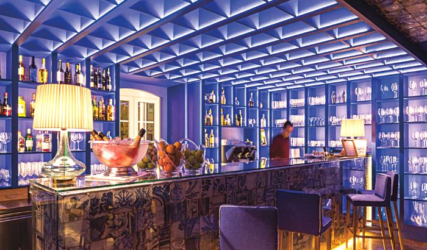
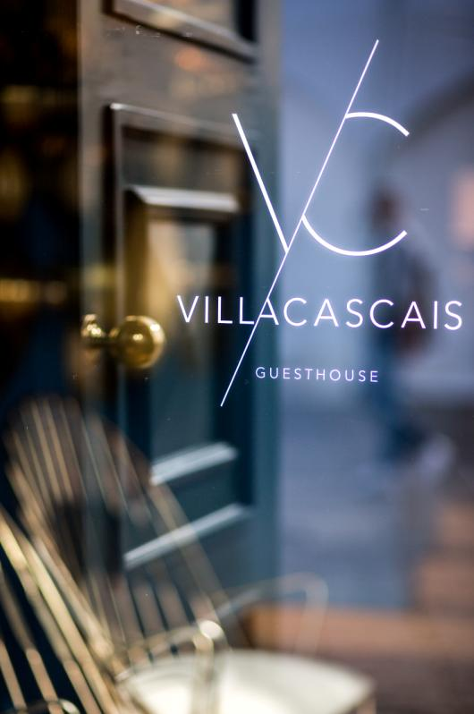
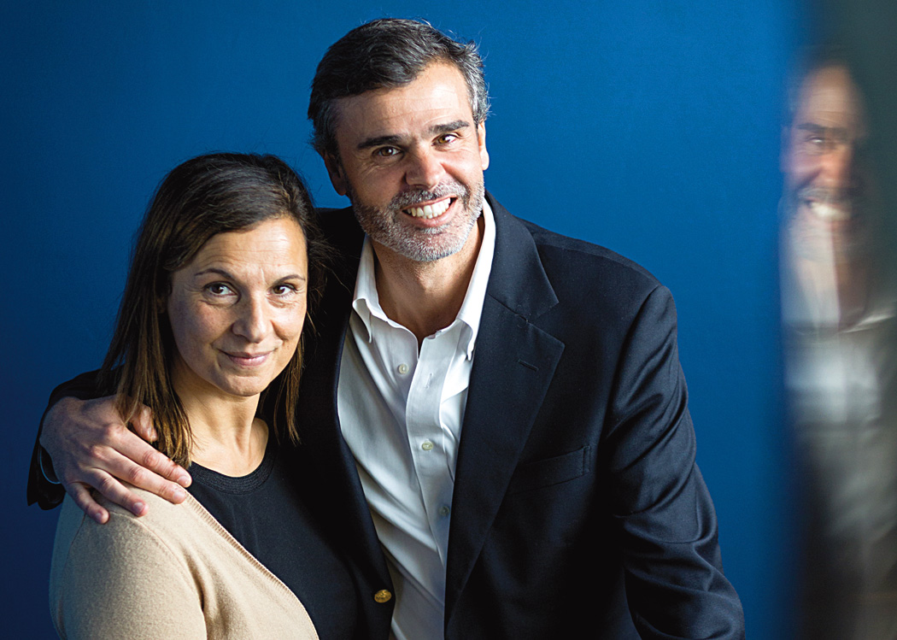
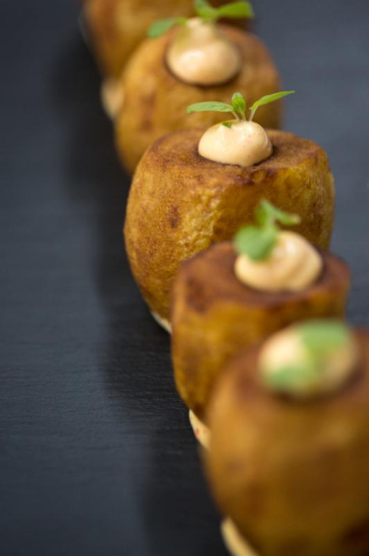

ENCONTRE O SEU DESTINO

Trazemos o mundo até si!  
Guias de viagem, dicas, hotéis, cultura e tudo o que precisa de saber sobre o seu destino

DESCUBRA PORTUGAL

Portugal tem muito para oferecer.  
Porque não partir à aventura pelos recantos menos explorados?  
Esperam por si momentos inesquecíveis!

### Outrora considerada a irmã mais nova do Hotel Albatroz, a guesthouse reabriu portas em outubro. Distanciou-se do parentesco e ganhou imagem nova e identidade própria.

Texto de Marlene Rendeiro - Fotografias de Sara Matos/Global Imagens *19 Dec 2015*

Frederico Simões de Almeida tinha apenas 8 anos quando o seu tio Carlos comprou a estalagem Albatroz, localizada no antigo palacete dos duques de Loulé, em Cascais. Assistiu ao início da incursão familiar na hotelaria, pautada pela filosofia de comprar edifícios históricos e transformá-los em hotéis de charme. E durante anos brincou com o seu primo naquela propriedade, que se foi expandindo às três casas nobres adjacentes, que hoje compõem o famoso Hotel Albatroz. Frederico é o único dos Simões de Almeida ligado a estas unidades.

Entretanto, a família Albatroz cresceu com a aquisição de outra residência senhorial, localizada« a 300 metros de distância, junto à baía de Cascais. Construída em 1923 pelo arquiteto engenheiro Gallardo Coelho, a nobre casa amarela pertencera inicialmente à poetisa Maria Amália Vaz de Carvalho. Viria a transformar-se numa espécie de irmã mais nova do Hotel Albatroz, durante quase uma década. Com a entrada de novos investidores e compradores em maio do ano passado, esta *villa* distanciou-se do parantesco antigo para ganhar a identidade própria. Ganhou o apelido *guesthouse* e passou a usá-lo com orgulho, sempre sem negar a sua história.

Por esse motivo ainda é possível ver-se pelos três andares vários elementos que remetem para o clássico e o antigo. Basta olhar para a lareira de um dos 11 quartos, para as cadeiras, moldes de sapatos de madeira ou para os azulejos do século XVIII que preenchem o teto do bar para se perceber como o *vintage* ainda acompanha o *trendy* que esta guesthouse incorporou. Os créditos vão principalmente para o arquiteto de interiores da Villa Cascais, Paulo Lobo, que trouxe o azul do atlântico para dentro de casa, com um tom *royal* que reveste cada canto e parede das áreas comuns – incluindo o restaurante-bar.

Rita Alves Martins, diretora da unidade, e Frederico Simões de Almeida, responsável pelo The Albatroz Collection.

Reaberta desde outubro passado com esta nova imagem, a pequena unidade tem no seu coração o Reserva by Olivier, onde o *restaurateur* voltou às origens, recuperando alguns dos *best-offs* dos seus primeiros restaurantes. As entradas ocupam as duas primeiras páginas da ementa e fazem antecipar que verbos como tapear ou petiscar vão ser repetidos várias vezes na zona de restauração.

Aliás, o ambiente descontraído combina com a partilha de pratos como as semipicantes batatas bravas com ragu de tomate, o doce e salgado folhado de queijo de cabra com mel e a clássica tábua de enchidos e queijos, só para listar alguns. O restaurante, que está aberto ao público em geral, divide-se em várias salas, permitindo mais ou menos privacidade de quem o visita. Mesmo ao lado fica o bar, que mais à noite rouba para si as luzes da ribalta. Não só pelos azulejos que cobrem o teto e o balcão, mas principalmente pelas 48 referências de vinhos – do Barca Velha a Estêvão – em máquinas Enomatic. «Qualquer um pode fazer a sua própria prova de vinho e encher o copo, desde 30 a 150 mililitros», explica Frederico.

Tal como tudo neste hotel, dá-se espaço à independência do hóspede. Mais um sinal de que a velha villa surge renovada e atenta às novas tendências.

**Villa Cascais**  
Rua Fernandes Thomaz, 1  
Tel.: 214863410 Web: thealbatrozcollection.com  
Preços: A partir de 100 euros (quarto duplo)  
Horário do Reserva by Olivier: das 12h30 às 00h30, exceto segundas-feiras.  
Preço médio: 30 euros
