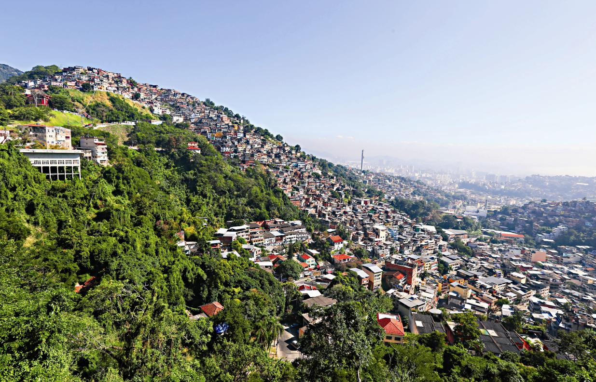
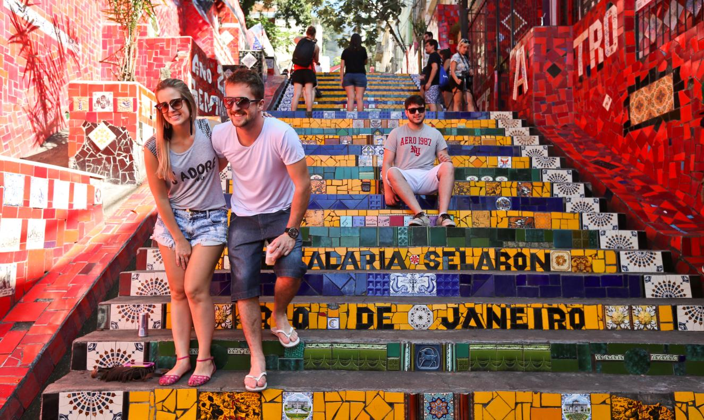
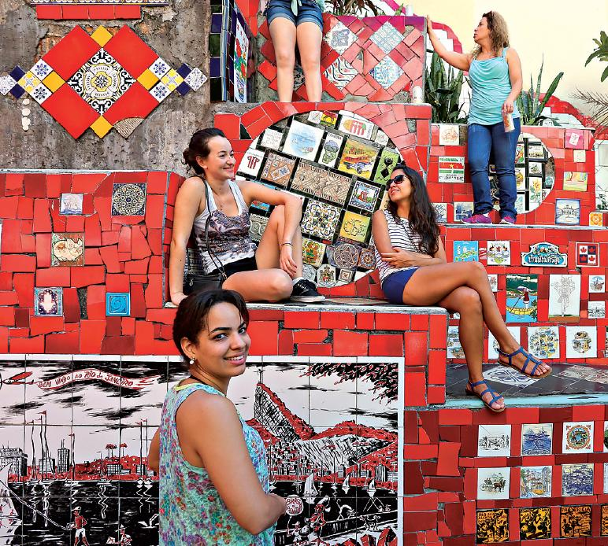
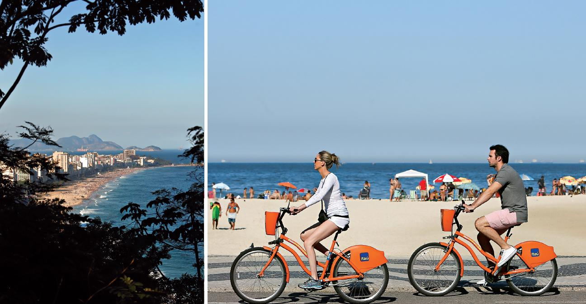
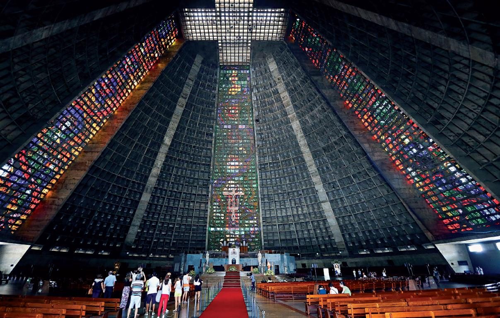
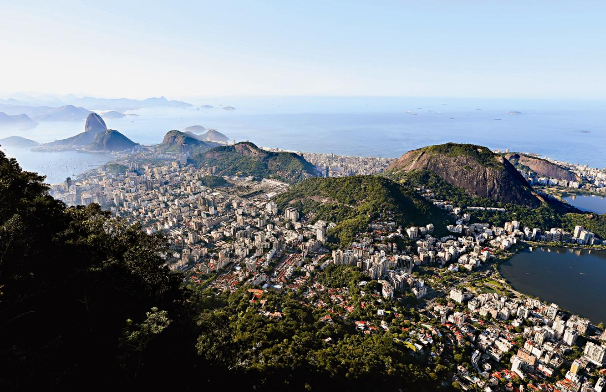
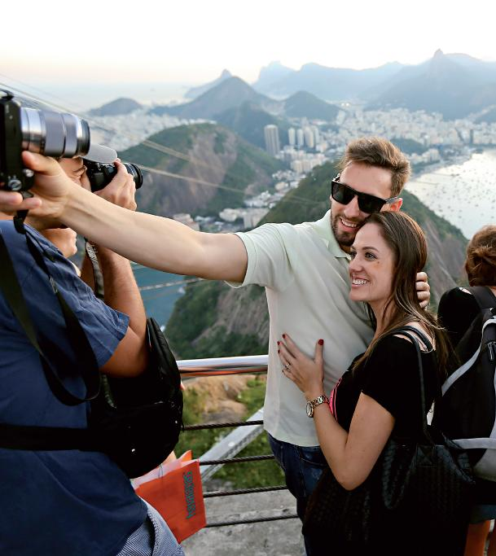

**Visitar o Rio de Janeiro é subir ao Cristo Redentor e sentir** vertigens enquanto o bonde desliza do morro da Urca até ao Pão de Açúcar.

**É sentir um frio na barriga quando se está** **no centro** histórico, é subir às alturas de Santa Teresa, descer à boémia Lapa e tomar um banho de mar em Angra dos Reis, onde há uma ilha para cada dia do ano.

«É um pouco como a subida do Chiado, em Lisboa», diz-nos, de sorriso aberto. Estamos no centro do Rio de Janeiro, a mais de treze quilómetros de Ipanema, Léblon e Copacabana. E as recentes férias em Portugal de Sandra Farias, guia turística, ainda estão bem frescas na memória. Talvez por isso, a habitual conversa com os turistas – «Cá é assim. Como é no vosso país?» – seja feita com constantes comparações a Portugal. O que não é surpreendente, se pensarmos na história comum.  
Mas já lá vamos.

Antes, importa saber que estamos em Santa Teresa, um bairro vizinho da Lapa, na zona central da cidade. Não acabámos de descobrir nenhum destino secreto. Do alto de uma serra, Santa Teresa tem testemunhado a história do Rio de Janeiro há pelo menos quatro séculos, depois de herdar o seu nome do primeiro claustro feminino do Brasil. Há cinco anos tinha apenas cerca de 40 mil habitantes e os turistas, por aqui, continuam a contar-se pelos dedos das mãos. «Não é uma rota muito requisitada», confessa Sandra Farias. É verdade, Santa Teresa é uma escolha improvável, com as suas pequenas casas de cores vivas, as moradias silenciosas e o vibrante verde do Brasil na paisagem. Quase parece uma parede de cortiça numa cidade com mais de seis milhões de habitantes, onde o ruído é uma constante. O glamour das festas do Copacabana Palace, a popularidade do Léblon e o areal de Ipanema ganhariam, certamente, muitos braços de ferro.

> **O Rio de Janeiro é a segunda maior cidade brasileira** quanto a número de habitantes, mas a primeira em termos de notoriedade internacional. Cristo, Carnaval e muito mais.

Mas, como se precisasse de mais pontos a favor do que ser morada do Cristo Redentor, esta ganha quando se fala de tranquilidade e de vistas panorâmicas. Um dos símbolo deste bairro é o bonde (nome dado ao elétrico), que voltou a fazer soar os trilhos de ferro há dois meses. Esteve inativo durante quatro anos, depois de um descarrilamento no Largo do Curvelo provocar a morte de seis pessoas. Aliás, é aqui que agora termina a nova rota, tendo início no Largo da Carioca. O que não representa nem 20% do percurso original. É apenas um trecho, já que o elétrico está em fase de testes até ao fim de setembro e as obras só têm conclusão prevista para 2017.

Nem só de vistas panorâmicas do Corcovado e do Redentor se faz Santa, como é carinhosamente apelidada pelos cariocas. A primeira paragem é o Largo das Neves. À primeira vista, esta praça parece ter pouco mais para oferecer aos turistas do que uma pequena capela. Basta contorná-la para perceber o motivo da pausa. Atrás do edifício, encontra-se um miradouro que descortina grande parte da cidade. Em Santa Teresa, não é difícil encontrá-los. Metros acima, novo mirante, como por aqui são chamados. Desta vez, apontam-nos para uma favela, ao longe. É lá que fica o Morro dos Prazeres, que foi cenário dos filmes *Tropa de Elite* e *Velocidade Furiosa 5*.

Talvez o melhor e mais famoso mirante de Santa Teresa seja o do Parque das Ruínas. O antigo palacete de Laurinda Santos Lobo foi deixado ao abandono após a morte da herdeira da empresa Matte Laranjeira, conhecida por organizar glamourosas festas, às quais não faltavam artistas brasileiros e personalidades internacionais. No último andar deste recuperado edifício, que agora é um centro cultural, tem-se vista de 360.º para o Rio de Janeiro. Ao longe, distingue-se facilmente o Pão de Açúcar. O final do dia neste famoso morro, com o sol a desaparecer nas montanhas ao longe, a vista para o oceano e a cidade de Niterói porbaixo, é de gravar-se na memória.

Não é por acaso que Santa Teresa é também referida como a Montmartre carioca. Por aqui já passaram artistas como Carmen Miranda e Jorge Selarón, o chileno que se apaixonou pelo Brasil e pela escadaria do antigo convento, que batizou com o seu nome. Começou a decorar cada um dos lances de escada nos anos 1990, mas foi graças às peças vindas de todas as partes do mundo que conseguiu terminar a obra, no início do novo milénio. São mais de dois mil azulejos diferentes que figuram, em mosaico, nesta colorida escadaria. Mas a história de dedicação de Selarón não tem final feliz. O corpo do artista foi encontrado na escadaria do Convento de Santa Teresa em janeiro de 2013. Estava carbonizado. A investigação continua a decorrer. As suas palavras ficaram gravadas nos últimos degraus: «Só acabarei este sonho louco e inédito no último dia da minha vida.»

Lapa, a boémia. Mais uma comparação com a capital portuguesa: «É um pouco como o Bairro Alto», diz Sandra. Por aqui, chamam-lhe o bairro boémio, dos artistas e das festas. Há trinta anos, a Lapa estava abandonada, não havia investimento, contam-nos. Mas, pouco a pouco, vai sendo recuperada. Este bairro é vizinho de Santa Teresa, mas os poucos metros que os separam deixam margem para uma grande diferença. Se Santa é tranquilidade, Lapa é agitação. Na primeira noite, percebemos o motivo da comparação inicial, mas na verdade, a Lapa tem poucas semelhanças físicas com o Bairro Alto. Só a tradição é a mesma: em vez de um bar, entra-se num boteco para pedir uma bebida. Em vez de se ficar nas ruas de Lisboa, vai-se bebericando em pleno centro do Rio de Janeiro. Mas os amigos estão lá, a música também, bem como o espírito descontraído, tão característico do povo brasileiro.

A Catedral do Rio de Janeiro foi inaugurada em 1979 e é da autoria do arquiteto Edgar Oliveira da Fonseca. Tem capacidade para 20 mil pessoas de pé.

Numa cidade em que o clima é convidativo, independentemente da estação do ano, é natural ver as ruas encher pela noite dentro. E a Lapa é a prova que a festa faz-se quando um homem quiser. Há as baladas mais improvisadas, os botecos, os bares mais antigos e os mais icónicos, como o Rio Scenarium, ao lado da Praça Tiradentes, onde se encontra a estátua de D. Pedro IV de Portugal (I do Brasil). Ou, ainda, perdoe-se a referência, o bar das Quengas – assim chamado pela decoração (roupa interior pendurada no teto). Desfilar pelas ruas da Lapa à noite é uma viagem pelos vários ritmos brasileiros. «Ir para a balada», como se diz por aqui, não é exclusivo da sexta e do sábado. Durante a semana, bares e boîtes fazem parte do itinerário de turistas e locais. Já lá dentro, poucos são os que ficam encostados ao balcão e as letras das música sabem-se na ponta da língua.

Por baixo daquele que é um dos símbolos deste bairro agrupam-se, todas as noites, jovens. Mesmo à noite, os arcos não passam despercebidos. Hoje não há muito mais para ver do que a construção em pedra branca mas, durante o dia, o antigo bonde voltou a circular no seu topo, ainda que por algumas horas (encontra-se também em fase de testes). Mas já se celebra o regresso do bondinho de Santa Teresa aos 42 arcos duplos, construídos em 1723, como um aqueduto para trazer água do rio Carioca para o centro.

«Minha alma canta, Vejo o Rio de Janeiro, Estou morrendo de saudades Rio, Seu mar, praia sem fim Rio, Você Foi feito prá mim». Tom Jobim, Samba do Avião

Mesmo quando a noite acaba tarde, o dia começa cedo na Lapa. A um sábado de manhã testemunha-se a azáfama de dezenas de comerciantes, que vão compondo as suas bancas. As frutas exóticas e as ervas aromáticas convivem ao lado dos mais variados tipos de malaguetas. Há as amarelas, as laranjas, as verdes e as vermelhas e um prato chega a custar apenas três reais (o equivalente a 75 cêntimos). No ar, os cheiros misturam-se e os olhos não sabem o que focar, com tanta cor. «Ananás tem de ter massa amarela», vai cantarolando um dos comerciantes. E, por falar em amarelo, não se esqueça que pedir um limão no Brasil – é o equivalente a pedir uma lima.

As feiras e os mercados abundam no centro da cidade. Uma das mais conhecidas é a do Lavradio, que se realiza todos os sábados, com peças de artesanato, esculturas, mas também velharias, malas antigas, discos de vinil e até máquinas de escrever. É também na Rua do Lavradio, mais afastada dos botecos, que se encontram alguns dos melhores restaurantes da Lapa. Pastéis de carne, bolinhos de bacalhau, feijoada ou aipim frito são alguns dos petiscos a provar. Apesar da proximidade dos cariocas ao mar, a carne continua a ser uma preferência. Ainda assim, junto ao forte de Copacabana, encontra-se uma alternativa para os amantes de peixe. É aqui que se localiza uma das muitas colónias de pescadores do Rio de Janeiro. As vantagens? O peixe salta diretamente do mar para o mercado, sem passar pelo gelo. Corvina, anchova, robalo, pescada, camarão, garoupa… «É só chegar cedo e escolher. Um quilo a 10 reais» – pouco mais de 2,50 euros –, diz-nos um dos pescadores.

A cinco minutos a pé da Rua do Lavradio fica a catedral São Sebastião do Rio de Janeiro. Com 75 metros de altura, o edifício é um ponto incontornável. Inaugurada em 1976, a construção foge ao estilo de uma catedral católica, falando esteticamente. Foi inspirada na pirâmide que os Maias construíram no Iucatão, México, e tem capacidade para cinco mil lugares sentados e 20 mil de pé. No interior, quatro vitrais cruzam-se para formar uma cruz no teto e, ao fundo do presbitério, avista-se a figura de São Sebastião, padroeiro da cidade. A poucos metros da Praça Compositor Braguinha fica também a nova unidade do grupo hoteleiro português Vila Galé no Brasil, inaugurada em dezembro de 2014, no centro da Lapa. Ali próxima está a Igreja de Nossa Senhora do Carmo, cuja capela foi convertida em capela real, por ser próxima da residência de D. João VI e sua família, no edifício do Paço Imperial. Este localizava- se na ainda existente Praça XV, que durante a época colonial foi apelidada de «centro da cidade». Foi daqui que a família real embarcou para o exílio em 1889. Quando nos dizem «esta praça é tão histórica quanto a do Terreiro do Paço», já não estranhamos. Quase 200 anos após a independência do Brasil, ainda se sente Portugal no centro do Rio.

## **Dormir**

**Vila Galé Rio de Janeiro**  
Juntou-se à rede Vila Galé no Brasil em dezembro de 2014. Localizada no centro histórico da Lapa, esta sétima unidade do grupo português foi em tempos um antigo palacete de 1886. Nos blocos mais antigos pode ainda observar-se os preservados mosaicos hidráulicos no chão, mas a decoração, essa é moderna e inspirada no samba. A piscina está no centro do empreendimento, junto ao bar Vinícius de Moraes e restaurante Inevitável, onde a cozinha é de inspiração mediterrânica. Conta ainda com spa, ginásio, sala de massagens e centro de convenções.

R. Riachuelo,124 – Lapa, Rio de Janeiro  
Tel.: (+55) 21 2460-4500  
Quarto duplo a partir de 122 euros por noite com pequeno-almoço  
vilagale.com

Percorra a galeria de imagens acima clicando sobre as setas.
