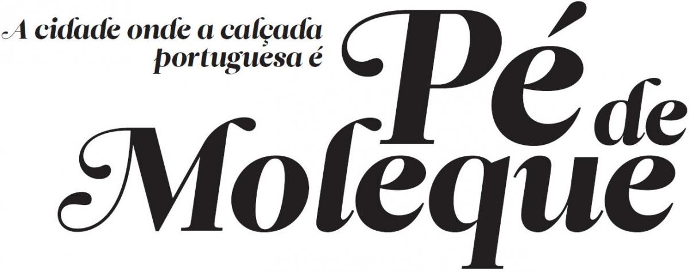
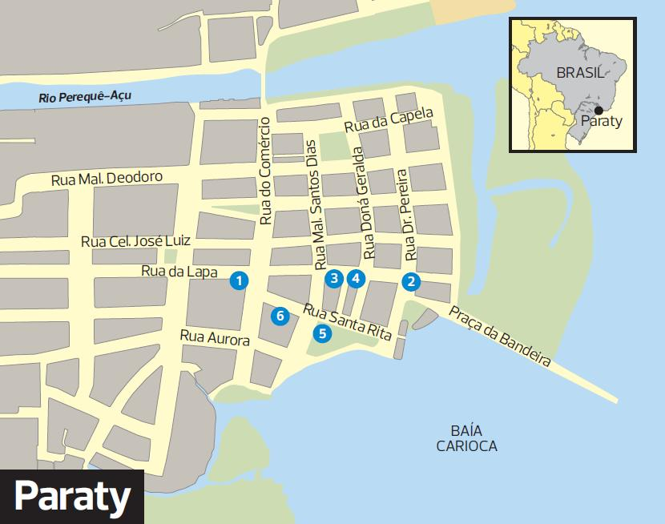
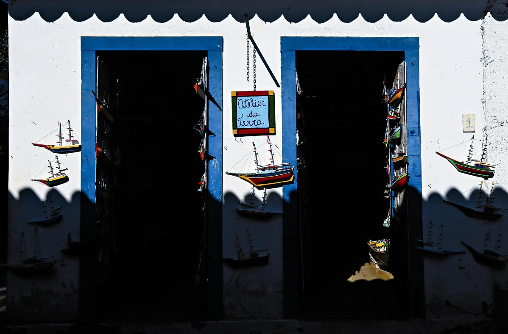
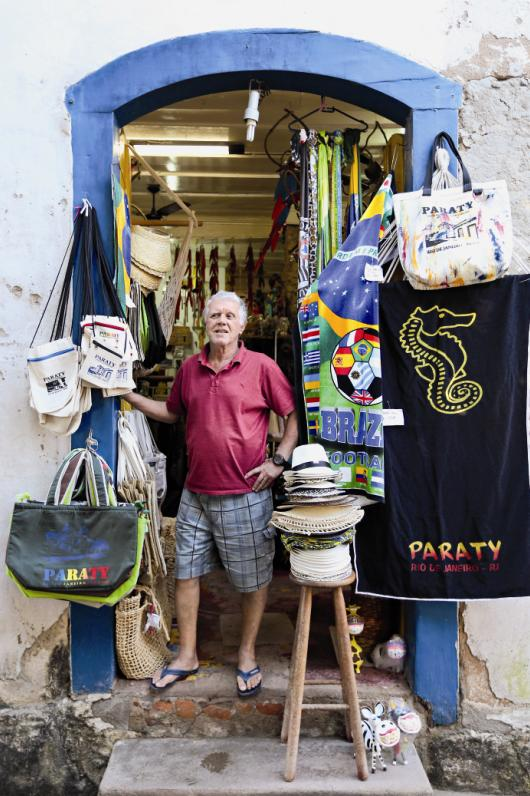
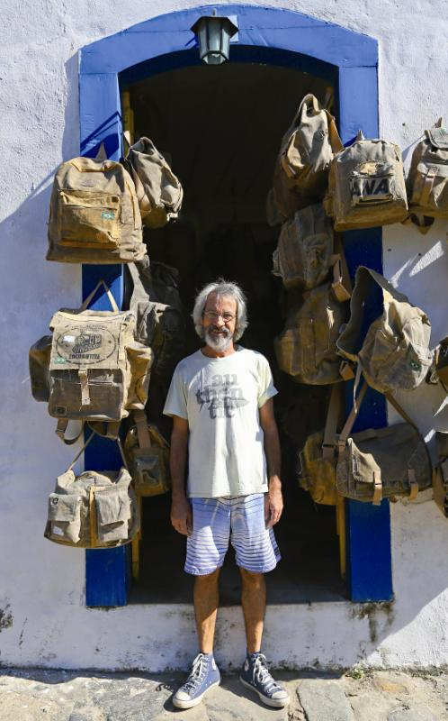
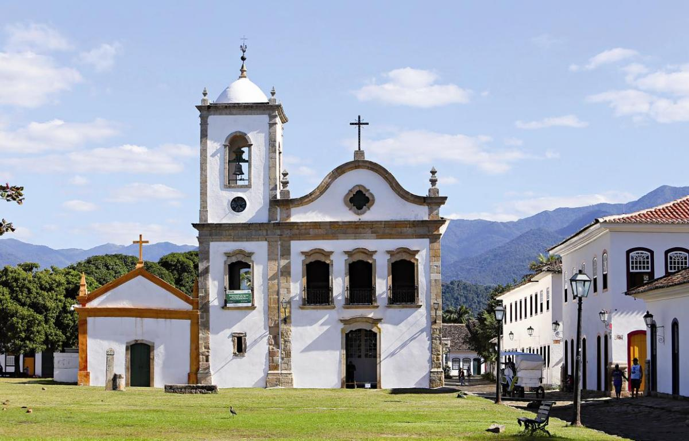
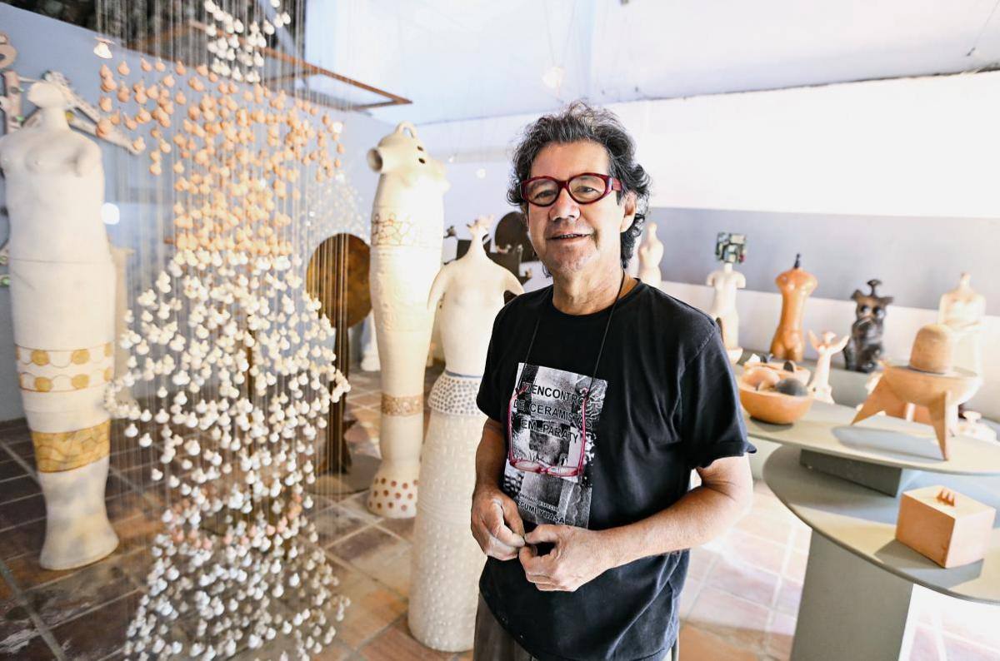

é-de-moleque é o que lhe chamam os paratienses. Não porque lembra o doce brasileiro, mas porque, reza a história, eram as crianças que iam dispondo as grandes pedras que cobrem o centro histórico de Paraty. Para os portugueses o pé-de-moleque resume-se noutra expressão: calçada portuguesa. A técnica é a mesma e veio efetivamente de Portugal. Onde antigamente passavam carroças, hoje circulam habitantes, turistas e velocípedes. À entrada da Rua da Lapa, uma corrente com sinal de proibição não engana: há muito que os veículos deixaram de poder cruzar a famosa calçada.

Também a construção urbanística desta cidade, a mais de duzentos quilómetros do Rio de Janeiro, tem linha portuguesa. A cidade desenvolveu-se em torno da Igreja de Nossa Senhora dos Remédios, padroeira local. Com atenção, consegue avistar-se, por entre ruas e ruelas do bairro histórico, alguns traços da Maçonaria. A vida no centro pertence a artesãos e as casas são dedicadas ao comércio. Logo de manhã, os turistas aventuram-se e desequilibram-se na calçada que pede calçado confortável. São dezenas os artistas que expõem as suas criações de cerâmica ou de madeira, e que abrem, logo pela manhã, as portas dos seus *ateliers* nesta zona antiga de Paraty.

Do outro lado da marina, desfilam dezenas de pequenas embarcações, que pertencem a outros artistas: os do mar. É nestas, pintadas de cores alegres e vivas e repletas de almofadas, que se faz o principal negócio turístico: por cerca de 17 euros é possível navegar uma hora pelas águas de Paraty, com um dos senhores dos «sete mares», que conhecem de olhos fechados os melhores caminhos entre as ilhas e as praias de difícil acesso. Na língua tupi, Paraty é descrito como um peixe da família da tainha, muito comum naquela região. É normal esta ligação ao que vem do mar. Faz parte da magia da cidade.

### 

Cachaça, réplicas de barcos de madeira, artesanato variado, papagaios, roupa de lona, cerâmica, igreja que é museu. Paraty é tudo isto. E tanto mais.

### **(1) Armazém da Cachaça**

Rua da Lapa, 279  
Tel.: +55 (24) 3371-7519  
A bebida de aguardente de cana usada na caipirinha é a protagonista deste espaço da zona histórica. São mais de 1200 rótulos diferentes. Para os leigos pode ser como encontrar uma agulha num palheiro, por isso o melhor é pedir um conselho aos peritos no assunto, do outro lado do balcão. As mais populares da casa são a cachaça Maria Isabel (11,50 euros por garrafa), considerada a sétima melhor do país, e a Coqueiro, que tem estatuto por existir há 211 anos e ser considerada a mais antiga cachaça brasileira. Paraty conta também com a sua própria cachaça envelhecida: a Paratiana (11,20 euros). Este espaço, há cinco anos em Paraty, conta ainda com vinhos, licores e whisky. Para os paladares mais resistentes, a loja tem uma prateleira dedicada aos pimentos, dos menos aos mais picantes. A doçaria também está representada – há cocada cremosa com maracujá e abacaxi e doce de leite com coco em pasta.

### **(2) Atelier da Terra**

  
Rua da Lapa, 1  
*eco-paraty.com/atelierdaterra/br.htm*  
Tel.: +55 (24) 3371-3070  
Vai ser difícil (senão impossível) contar todos os barcos que se encontram no interior. Há embarcações de madeira em cada canto e recanto desta loja. E são de todas as cores e feitios. Ieve Guidi é um dos funcionários. Fala sobre o seu pai, Marco Alves, o criador do Atelier da Terra há 17 anos. A verdadeira responsável pela construção destes objetos é uma comunidade de pescadores do Saco do Mamanguá, constituída por trinta famílias. Aí são pintados por um dos dez funcionários do Atelier e saltam do armazém para as salas principais. «Neste momento temos dez mil barcos », afirma Ieve. As réplicas de madeira podem ir de 1,20 a 1200 euros, quando se fala em embarcações de maior dimensão. O espaço aposta ainda em remos, redes de pesca, quadros e chapéus, estilo panamá, que têm a sua própria divisão.

### **(3) Artesanato Caraguatá**

  
Esquina da Rua da Lapa com a Rua do Fogo  
Tel.: +55 123887-7099  
«Na casa do vovô tem sempre um real» ou «Vó é mãe com açúcar». São as placas de madeira que o «dizem», colocadas numa das prateleiras desta loja de artesanato que tem um pouco de tudo. Desde os letreiros com frases divertidas, passando por porta-chaves, chapéus, lustres em forma de conchas e lemes, o Artesanato Caraguatá tem ainda para venda dezenas de papagaios de madeira, que «sobrevoam» – estaticamente – o teto. Dos mais pequenos aos maiores, o preço varia entre 3,50 e 33,30 euros. Sérgio França, o discreto proprietário por detrás do balcão, dá apenas conselhos quando lhe são pedidos. Nascido em 1947 em Paraty, já foi presidente da câmara da cidade. Largou a política, mas continua a dominar a região na ponta da língua. Sabe, por exemplo, que a Rua do Fogo foi assim apelidada, graças à expressão que resumia alguns dos episódios ali vividos. «Sempre que os marinheiros chegavam do mar, esta rua enchia-se de duas coisas: bebidas e mulheres. Era por isso que se dizia: “Que ia pegar fogo”», recorda.

### **(4) Casinha da Lona**

  
Rua Dona Geralda (esquina com  
Rua da Lapa)  
Tel.: +55 (24) 99853-9340  
*casinhadalonaparaty.com/contato.html*  
No cruzamento da Rua da Lapa com a Dona Geralda, há mais portugalidade. António Carlos, o responsável pelo sucesso da Casinha da Lona é filho de portugueses – o pai da Póvoa de Varzim e a mãe do Minho. Criou esta loja há 15 anos e ela continua a encher-se diariamente com dezenas de curiosos. Não tem mãos a medir para os clientes que lhe vão fazendo perguntas sobre o material utilizado para construir as peças. Neste pequeno espaço, tudo é feito de lona. Há coletes, que custam cerca de 35 euros, malas, que podem chegar aos 42 euros, mochilas, carteiras, cintos e até outras peças de vestuário, tais como vestidos, saias e calças. Tudo feito neste tecido, usado em camiões e, mais tarde, reaproveitado por António Carlos. No início, em 1986, fazia apenas sapatos, às escondidas da mãe, que não o deixava costurar. «Dizia que era coisa de mulheres. Hoje costuro tudo», diz, com um sorriso.

### **(5) Igreja de Santa Rita de Cássia**

  
Largo de Santa Rita  
Tel.: +55 (24) 3371-8328  
*museus.gov.br/tag/museu-dearte-sacra-de-paraty*   
Pode não ser a igreja principal de Paraty, mas os paratienses chamam-lhe cartão-postal da cidade. Localizada a cinco minutos a pé da Igreja Matriz de Nossa Senhora dos Remédios, padroeira de Paraty, a construção foi fundada em 1722, pela Irmandade de Santa Rita dos Pardos (mulatos) Libertos. No início, era frequentada pelas classes mais baixas de Paraty. Muito mudou nas últimas décadas.

Apesar de, no século XVIII, ter sido transformada em matriz, devido às morosas obras na Sé, atualmente serve como Museu de Arte Sacra. No mês de julho, quando é celebrada Santa Rita de Cássia, há procissões, missas, ladainhas e cânticos e é a única altura do ano em que Santa Rita volta a funcionar como igreja. Reaberto no passado dia 13 de junho, após intensas obras de recuperação do espaço, o Museu de Arte Sacra recebeu serviços especializados de arqueologia, no último ano.  
As escavações permitiram identificar alguns vestígios históricos da outrora Igreja de Santa Rita, tais como ossadas e antigos alicerces. No exterior deste museu, ainda é possível observar-se o cemitério da irmandade dos homens pardos libertos de Paraty, que existe ao lado do templo.

### **(6) Atelier do Dalcir**

  
Rua Santa Rita, 65  
Tel.:+55 (24) 3371-1214  
*facebook.com/dalcir.ramiro*  
À entrada do nº 65 da Rua Santa Rita, é impossível não reparar no enorme vestido suspenso, que parece cair do teto. Custa mais de 35 mil euros, foi construído com pequenas figuras de cerâmica e ferro, é uma das obras mais conhecidas de um artista plástico, natural de Paraty. Dalcir Ramiro é um dos ceramistas mais conhecidos e antigos da cidade, mas não foi na terra natal que aperfeiçoou a sua arte.

Foi no município vizinho, Cunha, onde aprendeu a técnica indígena de produção em argila. Dalcir Ramiro dedica as suas criações à figura feminina. A esta série de peças que concebe dá o nome de Cunhã, palavra indígena que, em tupi- guarani, significa mulher. Coincidência ou não, é precisamente a sua mulher, Luciana Marsilio, a única a ocupar o seu atelier. Dalcir trabalha sozinho a tempo inteiro, contando apenas ocasionalmente com a presença da também artista plástica com quem casou. Ativo e entusiasta na comunidade de artistas de Paraty, o paratiense organiza também o encontro anual de ceramistas em Paraty, desde 2006.

O evento, que está prestes a celebrar a sua décima edição, já levou artistas portugueses até ao outro lado do Atlântico. Este ano, na semana santa, teve a presença da ceramista portuguesa Alice Diniz, que participou neste encontro com a sua criação Flores. É caso para arriscar que a portugalidade continua bem presente em Paraty.

Texto de Marlene Rendeiro - Fotografias de Leonardo Negrão/Global Imagens
