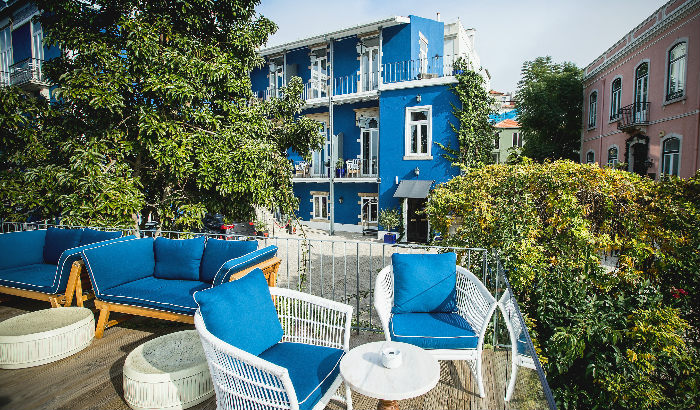

ENCONTRE O SEU DESTINO

Trazemos o mundo até si!  
Guias de viagem, dicas, hotéis, cultura e tudo o que precisa de saber sobre o seu destino

DESCUBRA PORTUGAL

Portugal tem muito para oferecer.  
Porque não partir à aventura pelos recantos menos explorados?  
Esperam por si momentos inesquecíveis!

### Um hotel composto por dois palacetes centenários, com quartos que levam nomes de rainhas e reis. E com um miradouro que desvenda uma vista impressionante de Lisboa. Bem-vindos ao Torel Palace.

Texto de Marlene Rendeiro - Fotografias de Orlando Almeida/Global Imagens *09 Jan 2016*

O convite de uma amiga, cuja filha estava a estudar em Portugal, fez que Barbara Ott aterrasse em Lisboa há ano e meio. Os cinco dias de férias iam ser passados num hotel de charme, numa das colinas da capital. «Assim que entrei no Torel Palace percebi que queria fazer parte dele», conta a austríaca com entusiasmo. Se lhe faltavam motivos para mudar de país, talvez os tenha encontrado ao espreitar pela varanda do quarto. Olhando para baixo, terá visto a impressionante paisagem: a vasta mancha de vegetação e, ao longe, o Tejo, a Rua Augusta, os Restauradores, as torres das Amoreiras.

Um cenário que causa ainda mais impacto a partir do miradouro e da piscina, no andar abaixo. Foi lá que Barbara se cruzou, pela primeira vez, com João Pedro Tavares, um dos dois sócios do Torel Palace, e lhe confidenciou que queria participar no projeto. Provavelmente não pensaram que voltariam a falar tão depressa. Mas uma semana depois o telemóvel de Bárbara tocava na Áustria. O segundo sócio queria «abandonar o barco» e o convite estendia-se, assim, à antiga farmacêutica.

A vinda de Barbara para Portugal marcava também o início de uma nova era no Torel Palace: a do palacete azul. Até maio do ano passado, o hotel funcionava apenas no palacete rosa, uma casa centenária, de onze quartos com nomes de rainhas. O hotel passou a estender-se à propriedade contígua. O espaço estava desocupado há dez anos e pertence ainda ao Patriarcado de Lisboa. Mas um forte investimento na decoração, assinada por Isabel Sá Nogueira, devolveu-lhe a vida.

> **Quartos com nome de reis e rainhas, interiores de requintado bom gosto, vistas deslumbrantes. É fácil perceber por que motivo Barbara Ott trocou a Áustria por Lisboa.**

Seguindo o exemplo do edifício rosa, o novo palacete viu os seus dezasseis quartos transformados em aposentos de rei, cada um com o seu nome: D. Dinis, D. Sebastião, D. Afonso Henriques, e a lista continua. Já no interior de cada divisão, percebe-se que a diversidade está bem presente. Nenhum quarto se assemelha a outro, tanto nas caraterísticas como nas peças de decoração, muitas adquiridas em leilões. Um dos quartos conta com os vitrais originais da casa, outro tem uma mala antiga a funcionar como móvel. Um terceiro dispõe de um cofre antigo, que nunca se conseguiu abrir. E outro, um terraço com azulejos coloridos no chão.

Além de novos quartos, o edifício azul permitiu ao hotel ganhar outros espaços. Caso da esplanada, junto às palmeiras ou do bar, em que o búlgaro Gueorgui Radkov prepara as dezenas de cocktails que integram a carta. Caso do restaurante Cave 23, inaugurado em novembro, na cave do Torel Palace – a contratação da chef Ana Moura era o que faltava para dar sabor à casa. A pergunta é escusada: aqui come-se como um rei, pois claro.

* * *

**Torel Palace**  
Rua Câmara Pestana, 23 (Bica)  
Tel.: 218298071  
Web: *torelpalace.com*  
Quarto duplo a partir de 120 euros por noite (inclui pequeno-almoço)
