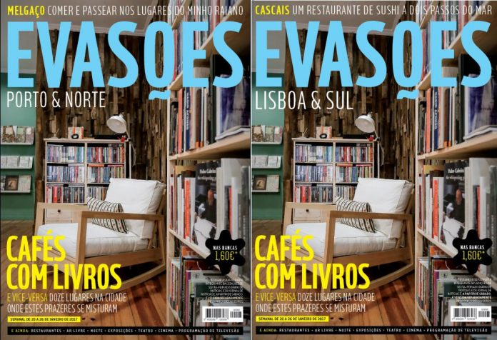

1 – No Porto, Matosinhos e Lisboa sugerimos doze lugares onde o prazer de um bom café se mistura com o prazer da leitura. São espaços onde se pode ler e comprar livros, revistas e outras publicações, e ainda tomar um café de torra artesanal ou preparação cuidada, assistir a tertúlias e exposições e ainda petiscar ou comer refeições ligeiras ou alguns petiscos de especialidade. 2 – Melgaço tem algumas novidades para conhecer, tudo obra de filhos da terra, alguns deles regressados do estrangeiro ou das cidades grandes. Falamos de um novo agroturismo, da primeira queijaria do concelho e de um restaurante na serra da Peneda. Neste roteiro de fim-de-semana, sugerimos ainda alguns lugares onde e obrigatório passar na vila \[…\]

[Leia mais em www.evasoes.pt](http://www.evasoes.pt/zdestaque-secundario/a-evasoes-de-20-de-janeiro-gratuita-a-sexta-com-o-dn-e-o-jn/)
