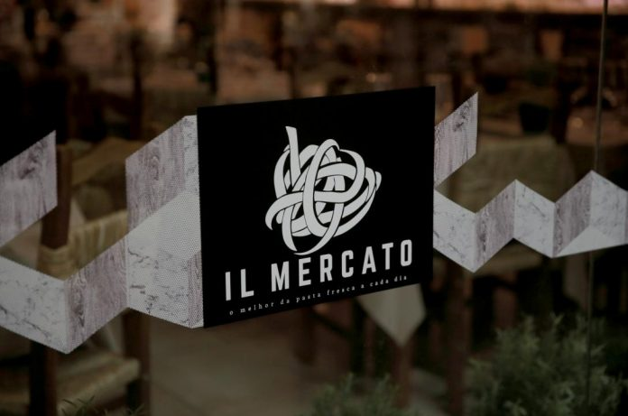

Primeiro foi o Come Prima, na Rua do Olival, depois o Forno d’Oro, na Rua Artilharia Um e agora, em pleno Páteo Bagatella, também na Artilharia Um, nasce o Il Mercato, completando a estratégia gizada por Tanka Sapkota. Bastante mais do que um restaurante, é um projeto inédito entre nós e resulta da vontade que o chef nepalês que Lisboa já não dispensa tinha de oferecer produtos gastronómicos italianos de bom nível. Entramos e estamos numa loja de delicatessen, massas frescas feitas no momento, queijos, carnes curadas, presuntos, enchidos e até a famosa trufa branca de Alba e preta do Piemonte ali se encontra sempre que possível. O chef Sapkota entendeu que «Lisboa merecia há muito uma mercearia italiana completa \[…\]

[Leia mais em www.evasoes.pt](http://www.evasoes.pt/comer/il-mercato-a-nova-mercearia-italiana-de-lisboa-que-e-tambem-restaurante/)
