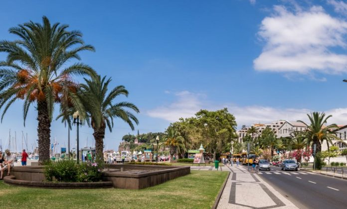

É uma das festas mais badaladas do país a que arranca a 22 de fevereiro no Funchal, Madeira. Este ano, a animação nas ruas prolonga-se até o primeiro dia de março e é uma boa oportunidade para partir à descoberta de outros espaços no centro da cidade. Restaurantes para parar numa refeição mais rápida ou prolongada, bares, uma gelataria, mercado ou um hotel que deu que falar no verão passado são algumas das sugestões para uma visita ao Funchal – na fotogaleria acima.   Leia também: A chegar: Festival do Butelo e Casulas em Bragança A avenida em Coimbra que se soube reinventar Tábua Cheia entrega petiscos no Grande Porto
