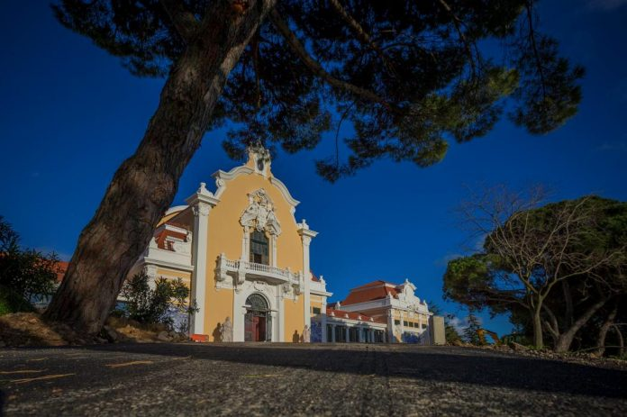

A reabertura do pavilhão marca o fim do projeto de requalificação, no valor de 8 milhões de euros, que terá como concessionária a Associação de Turismo de Lisboa durante 50 anos. Dois grandes eventos estão já marcados: o Peixe em Lisboa (30 de março a 9 de abril) e a edição de outubro da Moda Lisboa. A partir deste domingo e até 19 de março, estará aberta ao público uma instalação multimédia dedicada aos 20 anos do Turismo de Lisboa. E sempre que o pavilhão estiver aberto a eventos, será também possível visitar a exposição permanente dedicada a Carlos Lopes, que comemora, no dia de reabertura, 70 anos. Além da requalificação da sala principal, com cerca de dois mil metros \[…\]

[Leia mais em www.evasoes.pt](http://www.evasoes.pt/familia/este-fim-de-semana-todos-ao-parque-eduardo-vii/)
