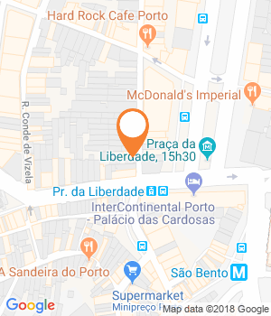

Na Rua do Almada, o espaço Miss Pavlova vai passar a ter, a partir de 15 de dezembro, um novo sabor de Natal, feito com os famosos bombons desta época do ano.

Quando um merengue de chocolate é coberto por uma fina camada de praliné de avelã, creme brulee de avelã e mousse de chocolate de leite, nasce a nova sobremesa da Miss Pavlova. A cafetaria, localizada dentro da loja multimarca Almada 13, no Porto, vai lançar a mais recente pavlova a partir de 15 de dezembro, pensada para a época natalícia. Vai poder ser encomendada para o Natal (32 euros por bolo) ou provada à fatia na loja ao fim de semana (3,50 euros).

A receita de Ana Maio, a Miss Pavlova que em 2015 se instalou na Rua do Almada, é ainda finalizada com bombons Ferrero Rocher e avelãs caramelizadas como topping. Vai manter-se no menu da cafetaria depois do natal, apenas durante os meses de inverno.

,%20Porto%20%0D%0ATelefone:%20915979517%20%0D%0AMais%20informa%C3%A7%C3%B5es%20em:%20https://www.evasoes.pt/local/miss-pavlova/)

Partilhar

,%20Porto%20%0D%0ATelefone:%20915979517%20%0D%0AMais%20informa%C3%A7%C3%B5es%20em:%20https://www.evasoes.pt/local/miss-pavlova/)

Partilhar

Morada

Espaço Almada 13, Rua do Almada, 13 (Baixa), Porto

Telefone

915979517

Horário

Das 10h00 às 19h00 e domingo das 13h00 às 19h00.

* * *

Website

Email

info.misspavlova@gmail.com

Facebook

* * *

GPS

Latitude : 41.1462478  
Longitude : -8.612239000000045

Comentários

#### Leia também:

[O novo brunch da Miss Pavlova pode ser provado todos os dias  
](https://www.evasoes.pt/comer/novo-brunch-miss-pavlova-todos-os-dias/)[6 hotéis e alojamentos para dormir em Gaia  
](https://www.evasoes.pt/fim-de-semana/6-hoteis-e-alojamentos-para-dormir-em-vila-nova-de-gaia/)[Comer bem em 10 restaurantes de «shopping» no Porto](https://www.evasoes.pt/comer/comer-bem-em-10-restaurantes-de-shopping-no-porto/)
