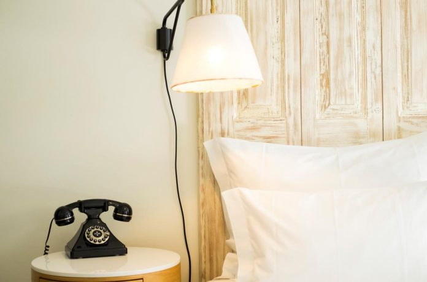

A. S. 1829 Hotel, anuncia o letreiro por cima do pórtico de vidros e ferro, no velho Largo de São Domingos, onde acaba a Rua das Flores, na baixa do Porto. É um letreiro enigmático e ainda mais quando, por baixo, permanecem as palavras Araújo e Sobrinho. De lado, para adensar o enigma, a montra, de loja antiga e clássica; em ouro e preto anuncia «acessórios para desenho e pintura». Quem espreitar a montra ficará também surpreendido: à primeira vista, tem, de facto, instrumentos de pintura e de papelaria. Porque ainda é uma verdadeira papelaria, a Araújo e Sobrinho, e é também o átrio deste hotel de charme e quatro estrelas que a mesma família abriu – em colaboração com \[…\]

[Leia mais em www.evasoes.pt](http://www.evasoes.pt/fim-de-semana/um-hotel-museu-numa-antiga-papelaria-do-porto/)
