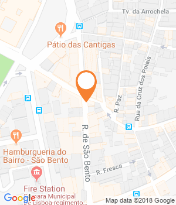

Baguetes de diferentes variedades convivem com gelados franceses na Baguettes & Cornets, espaço que abriu no mês passado, na Rua de São Bento, em Lisboa

Quando Patrick Hemond chegou há dois anos a Portugal trouxe com ele os gelados artesanais da Glaces des Alpes, marca que apresenta como «líder europeia no segmento de gelados profissionais». «São usados por chefs e nos melhores restaurantes, em França», conta o distribuidor, que elogia a ausência de aditivos, como corantes e intensificadores de sabor, nos gelados que representa. É a ele que pertencem os cornetos que dão nome à nova geladaria-padaria de São Bento: Baguettes & Cornets. Há gelados (com uma bola, a 2,50 euros) de bolacha francesa, de vinho do Porto, de pistácio e sorvetes de dezenas de frutas. Sempre com ingredientes que vêm diretamente do produtor.

A outra metade do negócio desvenda-se facilmente pelo nome e está sobre a responsabilidade de Christian Colmeau e Chloé, pai e filha, também proprietários de um restaurante na Rua de São Bento, o L’Anisette. Ela sabe de cor o nome das farinhas e a composição das diferentes baguetes, claro, e do pão com muesli e frutos vermelhos ou de limão, que enchem as prateleiras do balcão, à entrada.

Ao lado estão as especialidades de massa folhada: croissants simples, de chocolate e de frutos vermelhos, pain au chocolat, buns, e outra doçaria, onde cabem madalenas e os financiers, bolos de amêndoa franceses com chá matcha. Tudo para pedir quentinho e levar para casa, já que o espaço funciona apenas como take-away.

Intolerantes a glúten podem também provar os bolos e bolachas da certificada Nature & Cie, que estão entre alguns dos produtos que a Baguettes & Cornets vende. A estes juntam-se as charcutarias Bobosse (8,50 euros), uma creme de chocolate com avelã sem óleo de palma da casa Le Comptoir Mathilde (7,10 euros), bem como compotas variadas e ainda os chás da Compagnie Coloniale (14 euros).

Partilhar

Morada

Rua de São Bento, 78, Lisboa

Telefone

213951912

Horário

Das 08h00 às 20h00. Encerra segunda.

Custo

(€) Uma bola a 2,50 euros; duas, 3,50

* * *

Website

* * *

GPS

Latitude : 38.7111128  
Longitude : -9.152604200000042

Comentários

#### Leia também:

[Novas geladarias para ir antes do verão terminar  
](http://www.evasoes.pt/comer/lisboa-novas-geladarias-ir-do-fim-do-verao/)[Limonadas e panquecas para provar na Graça  
](http://www.evasoes.pt/comer/limonadas-e-panquecas-para-provar-na-graca/)[A nova casa de chá dos Anjos é um templo do pão de queijo](http://www.evasoes.pt/comer/lisboa-nova-casa-cha-um-templo-do-pao-queijo/)
