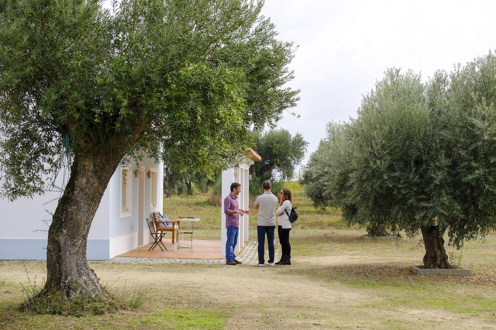
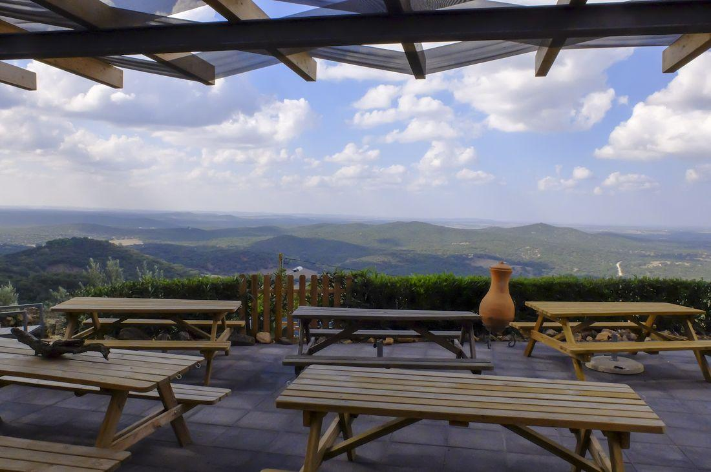
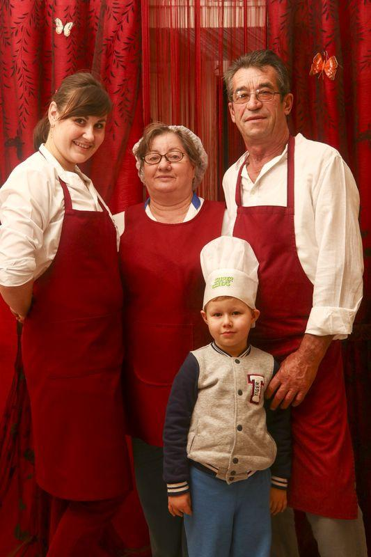
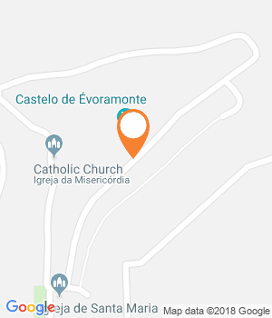
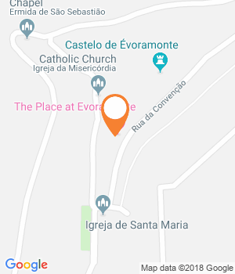
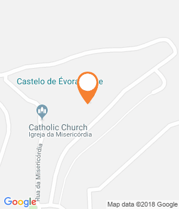
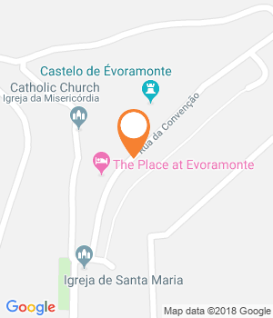
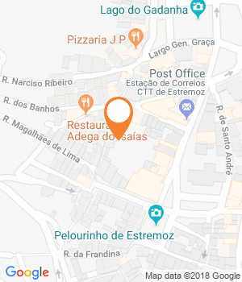
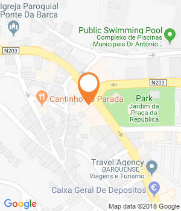

O castelo faz parar muitos curiosos desde a estrada que liga Évora a Estremoz. Mas a vila com 400 habitantes não se resume à fortaleza. Há um novo alojamento local, visitas guiadas e produtos regionais, a minutos de um olival e de uma quinta de vinhos.

Duas oliveiras destoam entre as mais de 200 companheiras no Monte da Oliveira Velha, a poucos quilómetros de Évoramonte. São anciãs bravas, com dois mil anos de vida, ali nascidas espontaneamente. Há 70 anos, o avô de João Miguel Rosado quis arrancá-las quando decidiu plantar o olival tradicional, alinhado com fileiras de trigo pelo meio. «Mas não havia máquinas para arrancar as raízes das rochas e assim foram poupadas», conta o professor de matemática de Évora, que há três anos decidiu pegar no antigo terreno do avô e fazer algo diferente com o olival.

O meu avô vendia as azeitonas a outras pessoas, mas neste momento a manutenção dava tanto trabalho que começámos a pensar em produzir. Diziam que estávamos a ser muito ambiciosos, só tínhamos 231 oliveira de variedade galega». **Hoje vai na sua quarta colheita de azeite Amor é Cego, nome sugerido pela designer Rita Rivotti**. Uma referência aos Bonecos de Estremoz (Património Cultural Imaterial da Humanidade) e à determinação da família Rosado.

A produção aumentou, entretanto, com a compra de outro olival tradicional a dez quilómetros dali, mas mantém-se de pequena escala. João apanha a azeitona mais cedo do que o habitual para garantir a sua qualidade; recusa-se a utilizar químicos, e retira o fruto com uma vara que não danifica os ramos da árvore. As azeitonas seguem depois para o lagar de um amigo, que lhe empresta o espaço uma vez por ano. **Tudo isto fica-se a conhecer numa ida ao Monte da Oliveira Velha, onde João organiza experiências de olivoturismo, como as degustações de azeite e de petiscos regionais.**

Os visitantes são quase sempre estrangeiros, muitos do Brasil e alguns da Nova Zelândia, Singapura e Coreia do Sul. «Acho que é importante educar as pessoas para a cultura do azeite», conclui João. «Todos deviam ter, pelo menos, dois tipos de azeite em casa para diferentes usos.»

O Monte da Oliveira Velha, onde é produzido o azeite O Amor É Cego (Fotografia: Paulo Spranger/GI)

**Uma fortaleza única**

Dali em direcção a Estremoz, toma-se a Nacional 18, e no caminho é impossível não reparar no castelo que surge a meio caminho. **É a fortaleza de Évoramonte, uma peça única de arquitetura militar, comparada por muitos ao Fort de Salses, em França**. O trabalho é atribuído aos irmãos Arruda, conhecidos pelas suas intervenções na Torre de Belém, no aqueduto de Évora e no Convento de Cristo. Apesar do aspeto de baluarte, não terá sido usado para fins militares. «Seria uma espécie de demonstração de poder da Casa de Bragança», conta Matilde Ruas da **Andar a Monte, uma empresa de passeios turísticos e visitas, que criou recentemente com a mãe, Helena.**

Matilde é tradutora de formação e regressou há um par de meses à sua terra natal, depois de uma temporada a trabalhar fora do país. A informação sai-lhe naturalmente, no percurso a pé que faz pela vila onde cresceu. «Toda a história de Évoramonte envolve muita especulação. Há falta de documentos e de escavações», explica. «O que se sabe é que as cinco portas de entrada foram mandadas construir por D. Dinis e que em 1531 há um terramoto que destrói quase toda a vila». Matilde sabe de cor os factos, mas também quase todas as lendas associadas à vila**. Fala-se da pedra dos Mouros que morreram de amor, do pêgo do Sino que será um portal para outro mundo e do túnel secreto que poderá ligar a fortaleza à ermida de São Sebastião.**

Na visita, que dura cerca de hora e meia, entra-se na restaurada capela da Misericórdia, passa-se pela casa onde o tratado da paz foi assinado entre os exércitos de D. Miguel e D. Pedro, e ainda pelas pedras da calçada, pintadas por Inocência Lopes, e espalhadas por toda a vila. Inocência já pintou mais de 50 pedras da calçada, cada uma representando uma diferente casa alentejana. «É um projeto que comecei há poucos meses e chama-se **Casas da Sensa**. O objetivo é pintar 100 pedras», conta a partir do Celeiro Comum, uma loja de artesanato e de produtos regionais que abriu há 14 anos na vila, «quando ainda não havia quase nada». É do seu ateliê que saem pequenas peças de decoração feitas à mão, como os presépios, mas por ali também se encontram bolachas, queijos, enchidos e mel para levar na bagagem.

A visita com Matilde só termina no escritório da Andar a Monte, na antiga Casa da Câmara. «Em breve vamos também organizar workshops de olaria e vamos ter um alojamento local». Quando se cumprir, será o segundo da pequena vila, a seguir ao **The Place**, que fica mesmo em frente. Um projeto de um casal vindo de Londres, que se deixou encantar por um cantinho alentejano, em frente ao Castelo de Évoramonte. **Mitch Webber já está à porta, sorridente, com o seu kilt azul forte, acompanhado pela mulher Vicky.** Ela, escocesa, ele, um publicitário sul-africano, conheceram-se na capital britânica há 18 anos; viveram num barco no Tamisa e viajaram pelo mundo, antes de aterrarem em Portugal, em 2013.

A calma alentejana convenceu-os e, três meses depois, estavam de volta à procura de um espaço para um futuro bed & breakfast. «Nunca tínhamos ouvido falar de Évoramonte, mas quando entrámos aqui e vimos esta paisagem soubemos que era o sítio certo», conta Mitch no terraço, onde em tempos funcionou um restaurante chamado Convenção.

A vista desde o alojamento local The Place.  
(Fotografia Paulo Spranger/Global Imagens)

**Três anos e muitas burocracias depois, o The Place abriu este verão, com três quartos e uma suite (com kitchenette).** A decoração celebra os gostos da dupla, com muitos livros e revistas de gastronomia e viagens, móveis rústicos feitos em Évora, quadros e posters de Tintim. «Dizemos que este é o sítio perfeito para conhecer o Alentejo. Daqui pode sair-se para conhecer nove castelos de diferentes vilas, o Cromeleque dos Almendres , o mercado de Estremoz ao sábado, o mármore de Vila Viçosa, os tapetes de Arraiolos… Ou então ficar pela vila e assistir a uma sessão de observação de aves», vinca Mitch.

No The Place, pode-se também petiscar durante o dia até às 20h00. Mitch e Vicky preparam uma piza de massa caseira, hambúrgueres e tábuas de queijos, mas ainda não se atrevem nas especialidades alentejanas. **Sorte que O Emigrante fica a uns 2 minutos de carro, já fora das muralhas de Évoramonte.** A cozinha alentejana é autêntica e o espaço pertence a uma família moldava, que chegou ao Alentejo faz 20 anos.

**A história de superação é contada por Natacha, 62 anos, a matriarca da família, que aprendeu os segredos e os temperos com as cozinheiras do lar onde trabalhou, durante anos.** «Perguntava-lhes pelas receitas e fui aprendendo», conta Natacha. «Quando abrimos o restaurante, há seis anos, as velhotas vinham cá ver como estava a comida da mãe», ri-se a nora, Iana, falando da sogra. «Ela já ganhou vários prémios aqui no Alentejo», acrescenta, enquanto coloca na mesa umas sarmale – folhas de couve recheadas com arroz.

Os pratos moldavos não estão no menu, mas Natacha prepara-os a pedido e já ninguém os estranha ao lado dos enchidos, dos queijos alentejanos, e de uma carne de cachaço de porco com migas que se desfaz só com um garfo. Vem acompanhada de batatas finas caseiras, fritas diariamente por Natacha, que se recusa a usar congelador. «Só uso produtos frescos, que compro aos agricultores», conta num dos habituais serões que se prolongam noite fora, no Emigrante, onde há comida a todas as horas. Afinal, um bom prato com boa conversa é língua universal.

**O primeiro vinho biológico DOC do Alentejo**

**A produção do Outeiros Altos, o primeiro vinho biológico DOC Alentejo, é visitável** e fica a 10 minutos de carro de Évoramonte, no Monte da Tapada Nova. E não é nada do que se espera. «Quem diz que o Alentejo é plano nunca veio aqui», resume Fernanda Rodrigues, apontando para a encosta do terreno com 22 hectares, quase às portas de Estremoz.

Encontrou-o há quase 20 anos anos, com o marido, Jorge, quando procuravam uma terra para produzir vinho DOC. «Queríamos uma vinha com xisto, com pedra e encontrámos este solo abandonado, sem químicos», conta Fernanda, prosseguindo: «Não tínhamos o direito de destruir a biodiversidade que aqui havia, por isso apostámos no biológico». Levantaram-se vozes de discordância, chamaram-lhes filósofos, mas Fernanda e Jorge, ambos licenciados em engenharia agrícola, contrariaram as previsões. **«Os nossos vinhos são elegantes e muito frescos, os franceses gostam muito deste perfil».**

A família do restaurante O Emigrante.  
(Paulo Spranger/Global Imagens)

Conseguiram-no estudando a morfologia do terreno, a sensibilidade das castas aos solos e à luz; e escolheram apenas castas portuguesas, incluindo **a Trincadeira, «que quase já ninguém usa»**. Tudo é pensado como um ecossistema, desde os cereais de inverno plantados entre as vinhas – «criam matéria orgânica» – até aos insetos, que são bem-vindos. «As aranhas, por exemplo, são um ótimo indicador da sanidade da vinha». Seis anos após a primeira vindima, estes pequenos produtores não têm mãos a medir. Mas arranjam sempre uns minutos para dar apoio às visitas guiadas à adega, feitas apenas por marcação, tal como as provas de vinhos com petiscos, que nos dias quentes acontecem com vista para a piscina.

**A loja onde fica o sino**

O edifício do século XVII ainda tem, no último andar, o relógio que faz tocar o sino da vila. Mas, desde agosto, que o espaço tem novas funções. **Pela mão de Sofia Bourbon nasceu a Silveirinha**, um 3 em 1, que é simultaneamente galeria de artes, mercearia de produtos regionais (sabonetes Nabia, produtos Terrius, compotas e chutneys) e ainda espaço de prova de vinhos da Herdade da Madeira Velha.

Morada

Rua da Convenção, 31, Évoramonte

Horário

Das 10h00 às 17h00. Encerra segunda e terça.

* * *

Facebook

* * *

GPS

Latitude : 38.7716169  
Longitude : -7.715730600000029

Comentários

Partilhar

Morada

Rua de Santa Maria, 26, Évoramonte

Telefone

927603884

Custo

(€) Quarto duplo a partir de 80 euros (pequeno-almoço incluído)

* * *

* * *

GPS

Latitude : 38.7711756  
Longitude : -7.716433700000039

Comentários

Partilhar

Morada

Rua da Convenção, 29, Évoramonte

Telefone

967916857

* * *

Facebook

* * *

GPS

Latitude : 38.7718392  
Longitude : -7.715850499999988

Comentários

Partilhar

Morada

38.771842, -7.715884

Horário

Das 10h00 às 13h00 e das 14h00 às 17h00. Encerra

* * *

* * *

GPS

Latitude : 38.7713583  
Longitude : -7.716021700000056

Comentários

Partilhar

Morada

Monte Da Oliveira Velha, Azaruja

Telefone

960117714

* * *

Website

* * *

GPS

Latitude : 38.682791  
Longitude : -7.774765000000002

Comentários

Partilhar

Morada

38.808047, -7.613038

Telefone

966250063

* * *

Website

* * *

GPS

Latitude : 38.8425123  
Longitude : -7.588837799999965

Comentários

Partilhar

Morada

Rua António J. Pereira, 24, Ponte da Barca

Telefone

258452248

* * *

* * *

GPS

Latitude : 41.8076604  
Longitude : -8.417361700000015

Comentários

Partilhar

Morada

Rua de Santa Maria, 11, Évoramonte

Telefone

966759534

* * *

Facebook

* * *

GPS

Latitude : 38.7711756  
Longitude : -7.716433700000039

Comentários

Partilhar

#### Leia também:

[5 sítios fantásticos para ficar na região do Alentejo  
Herdade do Freixo: vinhos e arquitetura juntos no Alentejo  
Há um refúgio escondido entre o Algarve e Lisboa](https://www.evasoes.pt/fim-de-semana/santiago-do-cacem-o-refugio-verde-escondido-entre-o-algarve-e-lisboa/)
