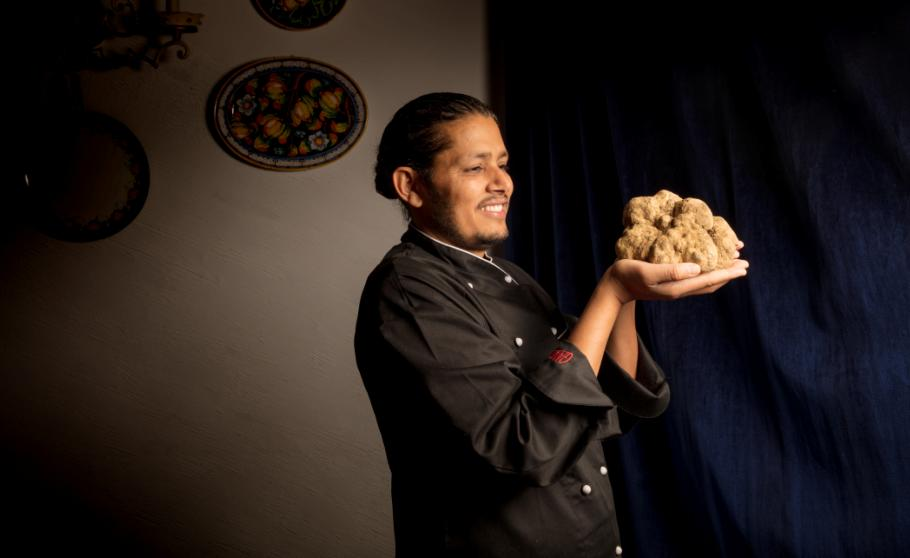

No ano passado, 900 gramas de trufa branca de Alba custaram 150 mil euros a um comprador internacional. Este ano, Tanka Sapkota do Come Prima, em Lisboa, quebra o seu próprio recorde ao comprar uma trufa de 1,127 kg.

Está aberta a época daquele que é um dos produtos italianos mais cobiçados pelos *chefs* e amantes de alta cozinha de todo o mundo: **a trufa branca de Alba, cujo preço por quilograma ascende os milhares de euros num mercado de negociações muito imprevisível.** Cada caçador de trufas (profissional especializado em «caçar» este ingrediente) fixa o seu próprio preço, dependendo da quantidade e da dimensão de cada uma. Só no ano passado, uma trufa de 900 gramas chegou aos 150 mil euros. «Este ano, 880 gramas foram vendidos por 85 mil», conta o nepalês **Tanka Sapkota, proprietário dos restaurantes italianos Forno d’Oro, Il Mercato e Come Prima**. É neste último que serve, desde 2007, pratos com trufa branca de Alba, como o risoto, o tajarin al tartufo (uma massa fresca muito fina) e o ovo cozido a baixa temperatura.

A cada início do inverno, quando começa a temporada, Tanka começa também as negociações com os seus caçadores de trufas. Este ano, além das trufas médias que costuma adquirir, conseguiu bater o seu recorde pessoal . «Conseguimos uma trufa de 1,127 kg», conta apaixonado sobre o produto de excelência, que começou a servir esta sexta-feira, no Come Prima. «A trufa branca não se cozinha, usa-se apenas finas lascas para finalizar os pratos, cerca de 8 gramas», acrescenta ainda Tanka, que foi nomeado por uma associação italiana Cavaleiro de Trufa. **Embora não revele o preço, admite que é praticamente impossível ter o retorno financeiro. «É um produto que se compra pela exclusividade e pelo prazer que nos dá trabalhá-lo», conclui.**

*Tanka Sapkota com a trufa de um quilo. (Fotografia: Jorge Simão)  
*

Exclusividade é a palavra certa para descrever um ingrediente que só está disponível dois meses por ano. É entre outubro e dezembro, todos os anos, que acontece a caça à trufa branca em Alba, Piemonte, Itália. Gosta de humidade, é selvagem e cresce a uma profundidade de 20 a 40 centímetros do solo, em florestas, normalmente junto a carvalhos. É por isso difícil de encontrar e todo o processo está envolto em secretismo**. Os caçadores de trufa fazem-se valer do talento de cães farejadores, ensinados desde que nascem a procurá-la (em tempos, foram usados porcos, mas o animal acabava por comer as trufas).**

Sobre a trufa de um quilo, Tanka conta que o processo envolveu dois dias de negociação, a intervenção de uma advogada, até que chegasse a Portugal a caixa com o «diamante branco». Com a lista de clientes que esperam, todos os anos, para provar a trufa branca, esta não deverá durar muitos dias no restaurante. Mas Tanka continuará a encomendá-la (em porções mais pequenas) até ao fim da estação, no início de dezembro.

Partilhar

[<!-- REVER: imagem não guardada localmente -->
](http://www.google.com/maps/place/38.7048613,-9.166375000000016)

Morada

Rua do Olival, 258, Lisboa (Madragoa)

Telefone

213902457

Horário

Das 12h00 às 15h00 e das 19h00 às 23h00. Encerrado ao almoço de sábado e domingo todo o dia.

Custo

(€€) 25 euros

* * *

Website

Email

reservas@comeprima.pt

Facebook

* * *

GPS

Latitude : 38.7048613  
Longitude : -9.166375000000016

Comentários

#### Leia também:

[Il Mercato: o novo italiano de Lisboa que tem mercearia própria  
](https://www.evasoes.pt/comer/il-mercato-o-novo-italiano-de-lisboa-que-tem-mercearia-propria/)[Lisboa: Abriu um italiano na Baixa com pizas e muito mais  
Novo italiano de Lisboa abriu ao pé da Gulbenkian](https://www.evasoes.pt/comer/novo-italiano-de-lisboa-celebra-o-lado-simples-da-vida/)
