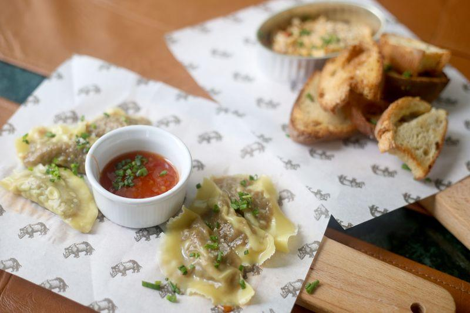
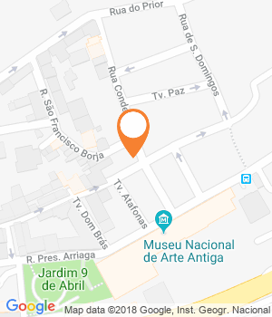

A cozinha de influência portuguesa vai muito além do bacalhau, mas também dos pratos típicos que todos conhecem. No Geographia ela vem carregada de especiarias, ao som de uma morna, ao brinde de uma caipirinha e ao doce de uma bebinca. Pelo meio, aprende-se História.

Muitas viagens começam com uma folha de excel em branco. A do Geographia também, embora o destino seja gastronómico. Nos meses que antecederam a abertura do restaurante junto às Janelas Verdes (e à casa de Madonna), Rúben Obadia, Miguel Júdice e a polaca Lucyna Szymanska foram acrescentando, célula após célula, **pratos de influência lusófona** que queriam ver ali representados. «O Miguel até enviou e-mails a uma senhora de Macau a pedir uma receita», ri-se Rúben, um dos três amigos e sócios do Geographia. «Tínhamos de ter cachupa, picanha e moamba de peixe. Mas não temos, por exemplo, chamuça porque nunca encontrei ninguém que a soubesse fazer como a comi em Goa», diz, avisando, no entanto, que «não é restaurante para saudosistas».

**As receitas nem sempre são tradicionais** e é por isso que o tradicional lassi de Goa aqui leva banana, e a caipirinha Gabriela, cravo e canela. O escondidinho de mandioca tem no recheio bacalhau à Bulhão Pato e o pastel de bacalhau usa esta raiz, no lugar da batata, pois é assim que o fazem em Timor-Leste. Uma forma de provar é pedir os fritinhos dos 4 continentes, uma tábua onde estão também representados Goa, Portugal e África sob a forma do tal pastel e ainda num frito recheado com sardinha e num croquete de carne de sol. Entre os pratos principais estão ainda um caril de camarão à Goesa, galinha do campo com caril de amendoim e, para sobremesa, bebinca de Goa e mousse de chocolate de São Tomé com salame do mesmo.

Dim Sum de minchi. (Fotografia de Diana Quintela/GI)

**Para o visitante não se perder na geografia, cada prato na carta tem assinalada a sua origem, e do mapa fazem ainda parte Macau, Moçambique e Brasil.** «Muitas vezes resumimos a cozinha portuguesa ao bacalhau e a outros pratos tradicionais. Esquecemo-nos que ela é muito mais vasta do que isso e que também assenta em especiarias», reforça Obadia. «Já havia bons restaurantes goeses, cabo-verdianos e brasileiros, mas queríamos uma síntese de tudo isto».

**O Museu Nacional de Arte Antiga, mesmo em frente, ajuda a contar esta história**, e também a equipa lusófona, liderada pelo chef brasileiro Carlos Bruno, que passou por vários espaços de alta cozinha na Irlanda, Peru e Argentina. As paredes cobrem-se de mapas, há um globo e uma antiga bandeira portuguesa ao balcão e a música de fundo a tocar é familiar, porque é feita uma curadoria musical lusófona. O café é de especialidade com grãos de Timor, São Tomé, Cabo Verde, Brasil e Angola e, brevemente, passará a ser vendido, juntamente com dois picantes caseiros.

**Nada foi deixado ao acaso no Geographia, desde os sofás confortáveis e os individuais de mesa, em pele, aos talheres dourados e pratos da Vista Alegre que têm um rinoceronte personalizado.** É o mesmo que está, em grande, numa das paredes, e tem uma história curiosa por detrás. «É um desenho de Dürer sobre um rinoceronte chamado Ulisses, enviado a D. Manuel I, que o ofereceu ao papa Leão X. Infelizmente o barco afundou-se e ele nunca chegou a Itália», conta Rúben, cuja paixão por história faz dele um perfeito cicerone neste Geographia. Falta falar no elefante no meio da sala, que é na verdade um macaco, agarrado a um poste. «Chama-se Magalhães, em homenagem aos 500 anos da circumnavegação de Fernão de Magalhães. Viveu no Zoo de Lagos e morreu de causas naturais», afiança. No final, até a conta, entregue num livro de Júlio Verne, ajuda a esboçar um sorriso.

Partilhar

Morada

Rua do Conde, 5 (Santos), Lisboa

Telefone

213960036

Horário

Das 12h00 às 15h00 e das 19h30 às 23h30. Encerra ao domingo.

Custo

(€€) Preço médio: 30 euros

* * *

Website

* * *

GPS

Latitude : 38.70556819999999  
Longitude : -9.16179139999997

Comentários

#### Leia também:

[Porto: 12 restaurantes onde comer boas sanduíches  
8 programas ao ar livre para o fim de semana em Lisboa  
Entrevista: «Fizemos as especiarias viajar mas deixámos de as usar»](https://www.evasoes.pt/comer/chef-paulo-morais-fizemos-as-especiarias-viajar-mas-deixamos-de-as-usar/)
