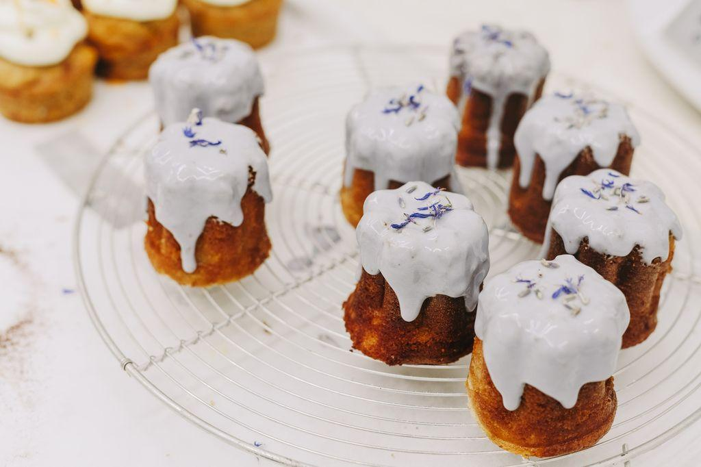

A Lab Padaria Portuguesa nasceu em fevereiro, nas Avenidas Novas, com uma decoração a demarcar-se das restantes lojas do grupo, mas também com novidades gastronómicas. Uma delas é o novo brunch.

O chão não é de mosaico hidráulico, o balcão não é preto com ditados populares, nem o pão é feito segundo métodos industriais. Na nova Lab Padaria Portuguesa que abriu na Avenida da República, a 26 de fevereiro, há muitas diferenças em relação às restantes lojas da marca. A começar pelo espaço (todo branco, a aproximar-se do ambiente das antigas padarias) e a acabar no brunch, uma das novidades que acompanhou a abertura deste laboratório de panificação e pastelaria da Padaria Portuguesa, aberto ao público.

Esta refeição é apenas servida ao fim de semana, entre as 09h00 e as 16h00 e, apesar de o pedido acontecer ao balcão, os quentes vão sendo levados à mesa conforme saem da cozinha. Logo ao início é pedido ao visitante que **opte entre os ovos turcos ou com salmão em pão brioche**. Já não é segredo que os primeiros têm merecido destaque no brunch. Levam iogurte natural, temperado com alho e especiarias, duas fatias finas de pão, ovos escalfados e são um consolo para o estômago.

É preciso escolher ainda entre as leves **panquecas de ricotta regadas a xarope de ácer e o porridge**, umas papas de aveia de cúrcuma e fruta; e ainda selecionar a bebida quente e o sumo natural que integra o brunch. Há sempre três à escolha e um deles é o já conhecido multivitaminas.

*Através das vitrinas é possível observar o trabalho no laboratório de pastelaria. É aqui que acontecem os testes para os bolos novos da Padaria Portuguesa.*

Não podia faltar, claro, o pão de fermentação longa desenvolvido pelo [padeiro Paulo Cardoso](https://www.evasoes.pt/comer/como-se-faz-o-novo-pao-artesanal-da-padaria-portuguesa/), até porque este é uma das grandes novidades do Lab, além dos novos bolos que ali são produzidos. **O laboratório de panificação está precisamente à vista do público** para que este possa acompanhar o processo e assistir ao desenvolvimento do pão de fabrico artesanal, preparado apenas com três ingredientes: farinha, água, sal e um extra, a massa-mãe (uma massa natural cujas leveduras têm função semelhante à do fermento).

**O Lab Padaria Portuguesa têm cinco pães artesanais à venda, dos quais dois são incluídos no brunch, o de mistura e a doce broa de milho**. No mesmo prato vem ainda um croissant, compota, manteiga, pasta de abacate, queijo e charcutaria. Por 16 euros, sai-se de barriga cheia, e ainda é possível adicionar extras ao brunch ou até partilhá-lo, no caso de querer uma refeição mais leve.

,%20Lisboa%20%0D%0ATelefone:%20217931571%20%0D%0AMais%20informa%C3%A7%C3%B5es%20em:%20https://www.evasoes.pt/local/a-padaria-portuguesa-lab/)

Partilhar

[<!-- REVER: imagem não guardada localmente -->
](http://www.google.com/maps/place/38.7376475,-9.146061799999984)

Morada

Avenida da República, 39 (Saldanha), Lisboa

Telefone

217931571

Horário

Todos os dias das 07h às 21h. Brunch aos sábados, domingos e feriados das 10h às 16h

Custo

(€) Preço médio da refeição: 10 euros por pessoa

* * *

Website

* * *

GPS

Latitude : 38.7376475  
Longitude : -9.146061799999984

Comentários

#### Leia também:

[Os pães doces da Malásia chegaram a Portugal. Saiba onde  
](https://www.evasoes.pt/noticias/os-paes-doces-da-malasia-chegaram-portugal-saiba/)[8 restaurantes para comer à grande e à alentejana em Lisboa  
Onde comer bom leitão assado em Lisboa e no Porto](https://www.evasoes.pt/comer/onde-comer-bom-leitao-assado-no-porto-e-em-lisboa/)
