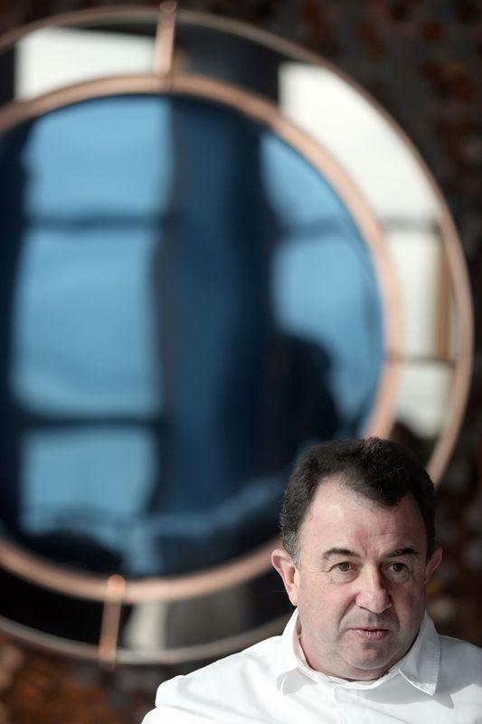

Foi num antigo bodegón de San Sebastian, que em tempos pertencera aos pais, que Martín Berasategui chamou, pela primeira vez, a atenção do Guia Michelin. Ganhou a primeira estrela dourada, em 1986, e nunca mais parou – tem agora dez no conjunto dos seus 15 restaurantes.

Na cerimónia do guia vermelho que aconteceu, na passada semana, em Lisboa, juntou à sua constelação de oito estrelas Michelin mais duas com os restaurantes Oria e Be Garrote a conquistarem, cada um, uma distinção. O rescaldo da cerimónia aconteceu no novo Fifty Seconds by Martin Berasategui, que abriu no topo da Torre Vasco da Gama, em Lisboa.

  
**Ao fim de 40 anos de carreira, ainda fica nervoso com a entrega das estrelas Michelin?**  
Sim, todos os anos. A cerimónia de entrega das estrelas só começou há uns anos, mas o Guia Michelin é uma instituição de prestígio desde há muito tempo, a melhor que documenta tudo o que acontece no mundo da gastronomia. É feito por inspetores que dedicam a sua vida a este guia e é o momento muito ansiado por todos os cozinheiros. Assisti à cerimónia aqui em Lisboa e fui surpreendido ao ganhar a nona e a décima estrela. Sou o único cozinheiro dos países falantes de língua espanhola a ter dez estrelas Michelin.

**O novo restaurante Fifty Seconds by Martín Berasategui, que acaba de abrir em Lisboa, foi pensado para juntar-se a essa constelação?  
**Os cozinheiros do Fifty Seconds foram todos formados no Lasarte (três estrelas Michelin, em Barcelona) e sei que a equipa dará o melhor de si. Se trabalharmos bem virá a primeira estrela, depois tentaremos a segunda e assim sucessivamente, tal como acontece com os outros projetos que tenho pelo mundo. Com a particularidade de que o Fifty Seconds é irrepetível pela sua localização. Trata-se de um restaurante a 120 metros de altura, no topo de uma das maiores torres de Lisboa, com uma panorâmica de 360 graus. Dos meus restaurantes, é o que tem a vista mais bonita.

**Abriria o Fifty Seconds em Lisboa, há 10 anos?**  
Ao longo dos meus anos de carreira tive muitas propostas para trazer a minha cozinha para Portugal. Disse sempre que não porque só faço as coisas quando acredito nelas. Tinha que ser com o grupo Sana. O senhor Nazir (proprietário do grupo hoteleiro) e o administrador Carlos Silva Neves (administrador) eram meus clientes no Martin Berasategui, em Lasarte. Gostavam da minha comida e quando me conheceram, simpatizaram, e apresentaram-me um projeto a que não podia dizer «não». Quarenta e oito horas depois da proposta estava em Lisboa a conhecer a torre Myriad e o projeto em que se iria transformar o Fifty Seconds.

O chef Martín Berasategui no seu novo restaurante de luxo Fifty Seconds, no topo da Torre Vasco da Gana.  
(Diana Quintela/ Global Imagens)

**A gastronomia ocupa também hoje um papel diferente, em Portugal.**  
Os cozinheiros portugueses fizeram um esforço enorme para captar as atenções de todo o mundo. Mas por detrás dessa atenção há muito trabalho de várias gerações de chefs. Acredito que quem trabalha, tem prémios à espera. E Portugal está a trabalhar no duro, como se viu na gala com a atribuição de mais estrelas. Acredito que o melhor ainda está por chegar.

**Porque escolheu o chef Filipe Carvalho para liderar a sua cozinha, em Lisboa?**  
O Filipe e a Maria (chef de pastelaria) já eram alguns dos melhores da sua geração quando estavam comigo a aprender, no Lasarte, em Barcelona. Têm um dom inato para a cozinha, por isso não tive hesitações na hora de escolher quem iria representar o grupo Martín Berasategui aqui em Lisboa. E depois foi muito fácil criar a carta. Divide-se entre os meus pratos de assinatura e outros, novos, criados com os produtos que nos oferece este país. Portugal é um dos templos de matéria-prima do mundo.  
  
**Fale-me do laboratório de criatividade que vai ter em Lisboa.**  
Em todos os restaurantes que tenho, em Espanha e na América Latina, sejam eles de maior ou menor dimensão, há sempre espaço para um banco de provas, onde exploramos a nossa criatividade. E o Fifty Seconds não vai ser exceção. O maior banco do grupo fica em Lasarte, onde estou eu, e temos 500 metros quadrados para fazer tudo. É neste banco onde todos os pratos e experiências nascem.

**Tem 15 restaurantes, dois com três estrelas Michelin, um com duas e dois com uma. Ainda consegue cozinhar?**  
As pessoas confundem as coisas. Eu só sei ser cozinheiro, dedico-me a criar, na cozinha. O resto, fazem-no outros: contabilidade, comunicação… ajudam-me em várias áreas. Tenho uma sala no Martín Berasategui, em Lasarte, onde faço vídeo-conferências com os responsáveis dos meus projetos gastronómicos. Nos dias em que o restaurante fecha, de domingo a terça, aproveito e vou visitar os espaços, que tenho pelo mundo. Mas ninguém me vê no escritório, estou sempre na cozinha a pensar em criar, em melhorar. Não me acomodo.

**A gastronomia mudou muito desde que começou a sua carreira?**  
Comecei a trabalhar, tinha 15 anos, no Bodegón Alejandro, dos meus pais. Inicialmente fazia-se cozinha simples, de mercado. Mas aos 24 anos eu já tinha ido para fora e já fazia comida muito moderna para a época, nesse espaço. Nunca tinham dado estrela a um bodegón, os clientes nem sabiam quem cozinhava no restaurante. Hoje em dia é mais fácil ser chef e é muito importante no meu país, em Portugal e no mundo, ser cozinheiro. O pressuposto mudou e fizeram de nós, chefs, personalidades, mas eu sou tímido e ainda sou a mesma pessoa do início.

**É uma grande pressão ser Martín Berasategui?**  
Depende como encarares o trabalho. A minha vida não muda nada por ter um restaurante. Eu sou um bon vivant, muito exigente comigo mesmo. Mas o meu êxito vem do trabalho de equipa. Tenho a agradecer aos meus mestres, que foram os meus pais e a minha tia, e à minha equipa, que me dá novas ideias todos os dias, enquanto lhes transmito o conhecimento que tenho. Podia ter ficado apenas com um restaurante, mas teria perdido muitas oportunidades, não só para mim, mas para a minha marca e o meu país. A cozinha espanhola e a portuguesa têm muito a dizer no mundo, mas há que dar o primeiro passo.

#### Leia também:

[Sommeliers: 10 mestres do vinho que deve conhecer  
](https://www.evasoes.pt/beber/sommeliers-10-mestres-do-vinho-que-deve-conhecer/)[Conheça melhor o primeiro Michelin de Guimarães  
](https://www.evasoes.pt/comer/a-cozinha-por-antonio-loureiro-conheca-melhor-o-primeiro-restaurante-estrela-michelin-de-guimaraes/)[Os outros restaurantes dos chefs Michelin](https://www.evasoes.pt/comer/os-outros-restaurantes-dos-chefs-michelin/)
