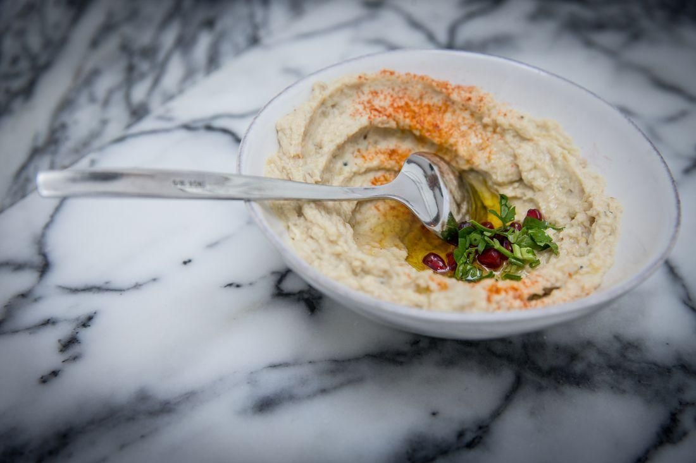
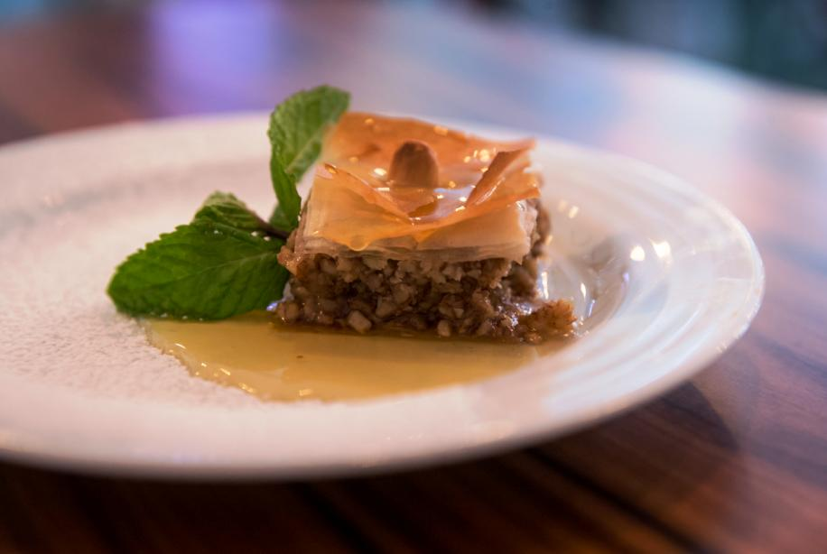
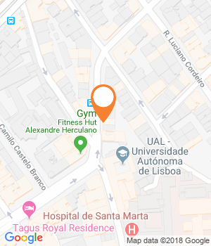
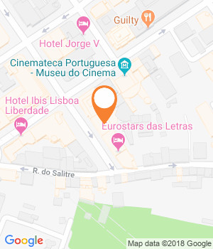
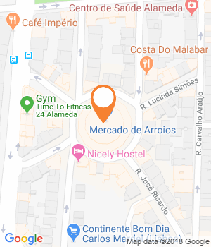
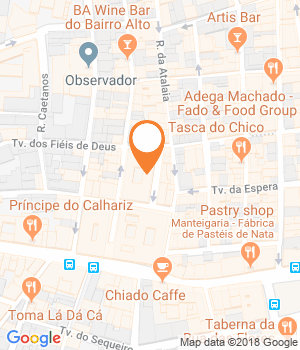
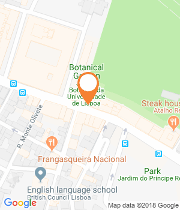
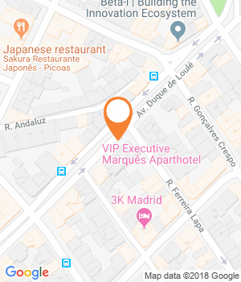
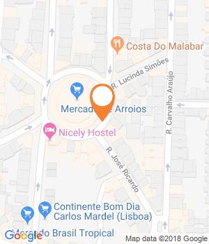
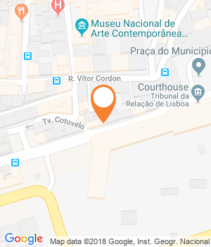

Há vinte anos, poucos saberiam o que era húmus ou babaganoush, mas hoje fazem parte das cartas de muitos restaurantes por todo o mundo. Lisboa não escapou à febre e, só nos últimos meses, abriram três restaurantes e uma padaria libanesa, além de uma mercearia de dois palestinianos. Mas o que terá, afinal, a cozinha do Médio Oriente para nos conquistar?

Grão-de-bico sempre casou bem com guisados e sopas portuguesas, além de fazer um par perfeito com o bacalhau. Mas nunca o moemos, juntámos pasta de sésamo, especiarias, limão e azeite. O húmus não nos pertence, mas nos últimos dois anos tomou conta das cartas de restaurantes, em Portugal e mundo fora. Seja como entrada ou parte do brunch, esta versátil pasta de grão tornou-se, subitamente, palavra internacional. «É o efeito de uma crescente preocupação com a cozinha saudável e o movimento vegetariano», diz Tarek Mabsout, nascido em Beirute, mas criado em Lisboa. É dono do **Atalho Real** e, recentemente, resolveu homenagear a avó libanesa ao abrir um segundo restaurante no Príncipe Real, o **Sumaya**.

A cozinha libanesa foi, talvez, a primeira a conquistar a capital a sério. Os **Fenícios**, aberto desde 2009, é uma referência na cidade, mas entre os mais recentes contam-se o restaurante-mercearia Casa dos Cedros que acaba de abrir no Marquês de Pombal (pertence à filha dos donos d**‘Os** **Fenícios)**; e, no Cais do Sodré, o **Muito Bey**, a padaria **Saj** **Baker**y e o **Za’atar**, fruto da parceria entre José Avillez e o chef de Beirute Joe Barza. «Comecei a promover a cozinha libanesa há 20 anos e acho que agora está entre as cinco melhores do mundo. É talvez das mais saudáveis», diz Barza. «Somos quatro milhões a viver no Líbano, mas espalhados pelo mundo fazemos 20 milhões. A gastronomia libanesa é conhecida no Brasil e nos Estados Unidos. Na Europa está também a crescer», continua o chef.

O húmus do Sumaya, o novo restaurante da Rua da Escola Politécnica, no Príncipe Real.  
(Jorge Amaral / Global Imagens)

Itamar Eliyahu, que abriu com o marido Elad Budensthteiin o restaurante israelita **Tantura**, no Bairro Alto, sublinha que a maioria das cozinhas do Médio Oriente em Lisboa são libanesas. Reforça, no entanto, que «há um movimento para abrir restaurantes de diferentes gastronomias do mundo na capital». «Antes parecia que só havia espaço para tascas, restaurantes, italianos e franceses, mas está a mudar. Fico contente por termos sido pioneiros com a comida israelita», diz Elad, que é de Tel Aviv.

É impossível não referir ainda o projeto de integração de refugiados sírios Pão a Pão, que deu origem ao restaurante [**Mezze**](https://www.evasoes.pt/comer/mezze-ha-novos-sabores-do-medio-oriente-em-arroios/), no Mercado de Arroios, e que inspirou um casal palestiniano, Serenah Sabbat e Hendi Mesleh, a abrir a sua mercearia no mesmo bairro, a **Zaytouna**. Vendem húmus em lata e babaganoush (pasta de beringela) para os mais preguiçosos, mas também produtos raros como cerveja com aroma de romã e o tradicional doce árabe de pinhões, o halawa. Com tantos pratos semelhantes, afinal o que separa e une a comida israelita, da libanesa, da palestiniana e da síria?

**A cozinha que é um «caldeirão de culturas»**

Levante é o termo geográfico dado à área que hoje conhecemos como Médio Oriente: Líbano, Síria, Jordânia, Israel e territórios palestinianos. Ou Grande Síria, como era conhecida a região até à queda do Império Otomano. Não é, por isso, de estranhar que grande parte das técnicas culinárias e forma de comer sejam comuns a todo o Levante. «Alimentos crus, o uso de ervas como ingredientes (e não apenas condimentos), sabores ácidos, temperos (como o za’atar), frutos secos (pinhões, pistácios), leguminosas, cereais, pão ázimo e azeite» são elementos comuns a todos estes países, refere Mina Holland no livro *O Atlas Gastronómico: Uma Volta Ao Mundo Em 40 Cozinhas* (ed. Lua de Papel, 2015)**. «Tratando-se de um local tão devastado por conflitos, a sua comida tem uma capacidade incrível de unir as pessoas, uma qualidade que se espelha na cultura da mezze** **da partilha de pratos**, mas também no número de pratos que diferentes países ou comunidades religiosas desta área têm em comum». «O libanês gosta de ter muita comida à frente», confirma Tarek Mabsout, dono do **Sumaya**. «Mas há uma ordem à mesa. Começa-se pelas mezze (pequenos pratos) frias, depois as quentes e no fim os grelhados.»

**Uma das discussões mais comuns prende-se com a origem de um destes petiscos, o húmus**. «É quase como perguntar quem inventou a vida? É uma eterna questão», diz Elad Budensthteiin do israelita **Tantura**. A forma de fazer varia de país para país e até de religião. «Nós, judeus, comemos húmus a partir do almoço; já os muçulmanos comem ao pequeno-almoço», acrescenta o companheiro Itamar: **«Um prato que não se vai ver no Líbano é a** **shakshouka \[ovos escalfados em molho de tomate e pimentos\], que originalmente é da Tunísia, mas foi introduzido na cozinha israelita».**

Esta é, aliás, a gastronomia que mais se destaca dentro do Levante, merecendo um capítulo próprio da autora **Mina Holland**. Esta descreve-o como um «caleidoscópio evolutivo do antigo e do moderno», citando o chef Yotam Ottolenghi, natural de Jerusalém. **Mina fala ainda de «uma cozinha em formação e a encontrar o seu lugar»** desde que, no pós-guerra, os judeus asquenazes (com origem da Europa Central) e os sefarditas (estes já nos anos 1970-80, vindos de Norte de África e Leste do Mediterrâneo) se fixaram em massa no território, trazendo as suas tradições e adaptando-as aos ingredientes locais.

Nas sobremesas predominam os frutos secos, como pistácios e amêndoas.

A verdade é que estes produtos-base da cozinha do Levante estão facilmente disponíveis em vários pontos do mundo, fazendo que os pratos sejam mais fáceis de exportar, vinca Joe Barza: «Em termos de sabor, a receita acaba por resultar da mesma forma num país estrangeiro». Barza fala do húmus, mas até este tem técnica na hora de fazer. «Encomendo grão-de-bico mexicano, de 12 milímetros, o português é mais pequeno. Coze-se em água com bicarbonato, lava-se outra vez, antes de lhe juntar o tahini \[pasta de sésamo\], as especiarias, azeite e sumo de limão», explica o chef libanês do Sumaya. Tradicionalista que é, recusa-se a fazer húmus de beterraba e outras variações, só para mostrar algo diferente. «Posso fazer e já fiz, mas não é melhor do que o húmus normal.» Que o caldeirão de culturas que é o mundo também nunca o desvirtue.

**Percorra a fotogaleria acima para conhecer os restaurantes que têm comida do Médio Oriente, em Lisboa.**

Morada

Rua do Conde Redondo, 141-A LISBOA

Telefone

212448703

Custo

(€€) 20

Horário

De terça a domingo, das 12h00 às 15h00 e das 19h00 às 00h00. Encerra à segunda-feira.

* * *

Website

* * *

GPS

Latitude : 38.7249951  
Longitude : -9.145963800000004

Comentários

Partilhar

Morada

Rua Castilho, 14 C, Piso 7, Lisboa

Telefone

213141045

Custo

(€€) Preço médio: 20 euros (restaurante)

Horário

Restaurante aberto das 19h30 às 23h00, fecha aos domingos. Level Eight aberto todos os dias das 17h00 às 02h00.

* * *

Facebook

* * *

GPS

Latitude : 38.7203466  
Longitude : -9.149022899999977

Comentários

Partilhar

Morada

Rua Angela Pinto Loja 22/23, Mercado de Arroios

Telefone

212494788

Custo

(€€) Preço médio: 25 euros

Horário

De terça a sábado, das 12h30 às 15h00 e das 19h00 às 22h30.

* * *

Facebook

* * *

GPS

Latitude : 38.7352595  
Longitude : -9.132670200000007

Comentários

Partilhar

Morada

Rua do Trombeta, 1 D (Bairro Alto), Lisboa

Telefone

218096035

Horário

Das 18h30 às 00h00. Encerra à segunda.

* * *

Facebook

* * *

GPS

Latitude : 38.711567  
Longitude : -9.145140999999967

Comentários

Partilhar

Morada

Rua da Escola Politécnica, 40 (Príncipe Real), Lisboa

Telefone

213470351

Horário

Das 12h00 às 23h00. Não encerra

* * *

Facebook

* * *

GPS

Latitude : 38.7173649  
Longitude : -9.149829700000055

Comentários

Partilhar

Morada

Av. Duque de Loulé, 1 E (Marquês), Lisboa

Telefone

218680041

Horário

Das 09h30 às 19h00. Sábado, das 10h00 às 18h00. Encerra ao domingo.

* * *

* * *

GPS

Latitude : 38.728067  
Longitude : -9.145002999999974

Comentários

Partilhar

Morada

Rua Ângela Pinto, 19 (Arroios), Lisboa

Telefone

926369317

Horário

Das 10h00 às 19h00. Encerra ao domingo

* * *

Facebook

* * *

GPS

Latitude : 38.73502209999999  
Longitude : -9.132244899999932

Comentários

Partilhar

Morada

Rua do Arsenal, 118 (Cais do Sodré), Lisboa

Horário

Das 11h00 às 20h00. Não encerra

* * *

Facebook

* * *

GPS

Latitude : 38.7074614  
Longitude : -9.140801099999976

Comentários

Partilhar

#### Leia também:

[10 restaurantes tradicionais chineses para ir em Lisboa  
](https://www.evasoes.pt/comer/10-restaurantes-tradicionais-chineses-para-ir-em-lisboa/)[8 restaurantes acolhedores para fugir ao frio em Lisboa  
](https://www.evasoes.pt/comer/8-restaurantes-acolhedores-para-fugir-ao-frio-em-lisboa/)[As novas e boas pizas artesanais de Benfica junto a um lago](https://www.evasoes.pt/comer/bozzolo-novas-pizas-artesanais-de-benfica/)
