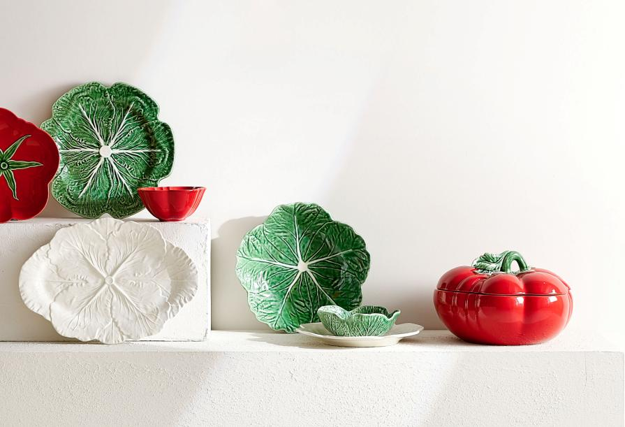

A marca especializada em artigos para a casa da Zara juntou-se à empresa de faiança portuguesa com mais de 130 anos de existência numa colaboração inédita. O resultado desta parceria luso-espanhola é uma coleção de serviço de jantar com oito elementos que seguem a linha da Bordallo Pinheiro, com os característicos vegetais a darem forma às peças.

As terrinas, os pratos e as travessas disponíveis são inspiradas em folhas de couve e de tomate e os tons variam entre verde, vermelho e branco. Já os preços começam nos 9,99 euros e vão até aos 99,99 euros. **Percorra a fotogaleria para conhecer, em detalhe, a coleção, que está disponível no site.**

> [Do algodão orgânico ao linho europeu: a coleção sustentável da Zara Home](https://www.delas.pt/do-algodao-organico-ao-linho-europeu-a-colecao-sustentavel-da-zara-home/)

> [Irmãs Hadid: o melhor e o pior do desfile da Moschino](https://www.delas.pt/irmas-hadid-o-melhor-e-o-pior-do-desfile-da-moschino/)
