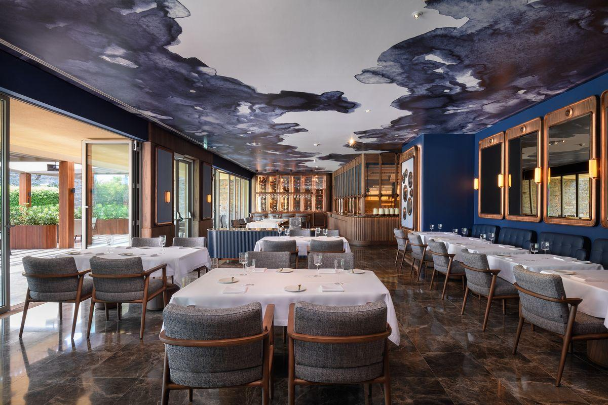
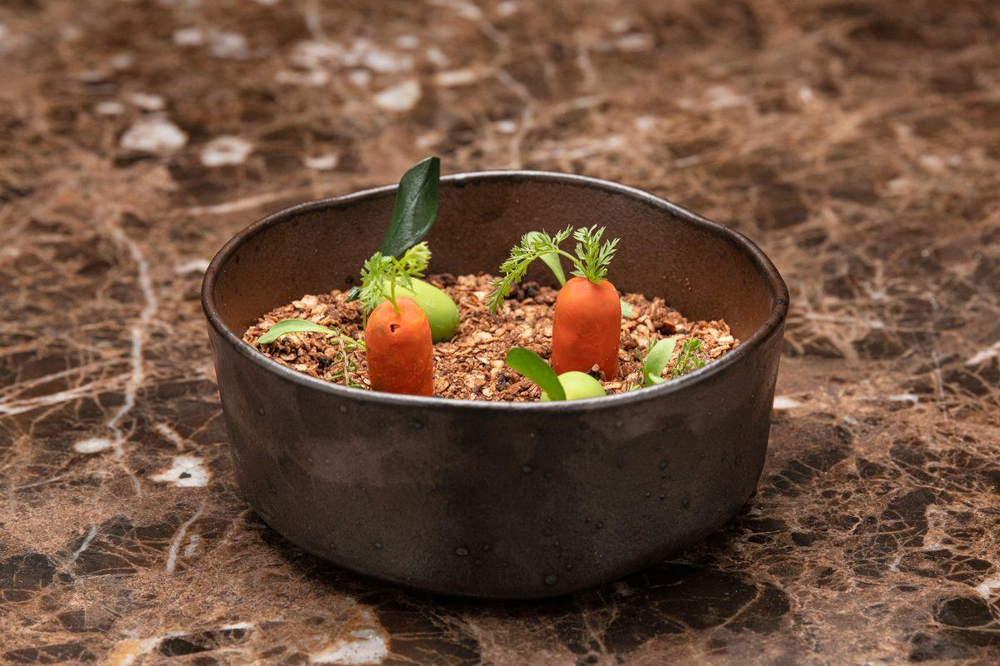

Há sempre bons motivos para voltar ao Epic Sana Algarve, entre Albufeira e Quarteira. A paisagem verde que se prolonga até ao acesso da Praia da Falésia, as **três piscinas exteriores,** os jardins privados de alguns dos quartos e duplex e os bares com boa onda são apenas algumas das razões que nos podem levar a sul, durante o verão.

Já o outono e o inverno pedem o aconchego do spa, muitas braçadas na piscina interior aquecida e uma **dose redobrada de pequeno-almoço** no restaurante Abyad, que inclui panquecas, muita variedade de *viennoiserie* e pão, omeletes feitas na hora, cereais, frutos secos e fruta fresca. Para quem valoriza a primeira refeição do dia, este é uma das grandes surpresas do hotel.

No entanto, a maior surpresa está no **renovado Al Quimia,** a grande aposta gastronómica do Epic Sana Algarve. O restaurante liderado pelo chef Luís Mourão já fazia parte do hotel desde há seis anos, destacando-se pelos anuais jantares sensoriais que se tornaram parte do seu ADN. No entanto, havia necessidade de mudar e de **acompanhar o desenvolvimento do trabalho feito na cozinha** com uma nova estrutura de restaurante. “Comparo o Al Quimia a uma banda que está em estúdio e que vai aperfeiçoando as suas músicas. Entretanto estas ganham novos elementos e começam a ficar mais complexas e mais sólidas”, revela Hugo Macedo, diretor de *Food and Beverage* do Epic Sana Algarve.

*O renovado Al Quimia reabriu no final de julho, com uma nova decoração e uma carta, com dois menus de degustação.*

A metáfora não podia encaixar melhor nesta nova fase do Al Quimia, que mudou não só completamente a carta – atualmente **com dois menus de degustação e outras opções a la carte** -, mas também totalmente a decoração. O teto é um dos elementos mais cativantes, representando uma “clareira numa noite de tempestade”, com tons de cinza, branco e azul-escuro.

Foram precisos **oito meses de trabalho para transformar o antigo espaço numa moderna sala de *fine dining*.** Em julho reabriu já com um total de 72 lugares, divididos entre a esplanada no exterior e a sala principal de refeições. “O cliente pode começar a experiência lá fora e transitar para dentro”, vinca ainda o responsável pelo departamento de F&B.

Das mesas aos candeeiros, que à noite nos transportam para outra época, tudo foi pensado ao pormenor. A **cozinha saiu dos “bastidores”** para estar bem à vista do cliente e está emoldurada numa elegante estrutura de madeira e de cor cobre, tal como os espelhos que dão vida à sala. Também os talheres, maioritariamente da marca portuguesa Cutipol, e os pratos da Vista Alegre mostram que a atenção está presente em todos os detalhes.

A transformação deveu-se, claro, ao trabalho da equipa de Luís Mourão na cozinha – já lá vamos -, mas também ao projeto de Nuno Rodrigues, do ateliê de arquitetura Stabörd, que desenhou o renovado Al Quimia. O arquiteto foi também responsável pelo **restaurante de alta cozinha Fifty Seconds do chef basco Martin Berasategui,** que pertence ao grupo Sana, e fica no topo da Torre Vasco da Gama, em Lisboa.

*Cenouras e azeitonas “falsas”*

Foi precisamente no país basco que esteve parte da equipa do chef Luís Mourão a desenvolver alguns dos pratos do novo Al Quimia, durante este hiatus. “Tivemos oportunidade de ir ao restaurante do Martín em San Sebastián fazer um pequeno *cross-training* para aperfeiçoarmos algumas técnicas”, afirma ainda Hugo Macedo. O resultado está à vista em pratos como o *amuse bouche*, que é **composto por azeitonas e cenouras falsas,** cujo recheio “explode” na boca logo ao início da refeição.

Apesar dos ensinamentos bascos, é de produtos portugueses e sabores nacionais que se fazem os dois menus de degustação do Al Quimia: **O Farroba**, dedicado aos produtos da terra, com 7 momentos (90 euros); e o menu **Maré Cheia (110** **euros)** , que destaca marisco e vários tipos de peixe em 10 momentos. Foi este último que o Delas.pt teve oportunidade de provar ao longo de três horas de refeição, com uma harmonização de vinhos feita pelo sommelier Hugo Ribeiro.

Se é verdade que o restaurante passou a incluir também uma carta de referências internacionais, continuou **a privilegiar-se os vinhos nacionais,** como aconteceu logo ao início do jantar, com um espumante da Bairrada a dar o tom certo a este recomeço.

Shots de maçã verde, tiborna com alho e bolo de tinta de choco com gamba foram apenas alguns dos primeiros momentos desta experiência, seguidos por outros que não lhes ficaram atrás, como o **Gelado de Bulhão Pato**; o **Língua quer Alho**, com língua de bacalhau, um **Cozido à Mar** com um dashi e uma sapateira a simular barriga de porco. E ainda as **estrelas da noite:** o Cataplini, uma cataplana com massa “tagliatelle” de choco; e o Baila, um dos peixes da costa algarvia mais consumidos pelos pescadores, mas pouco conhecido dos consumidores.

A garantia é de sair daqui com uma experiência da verdadeira cozinha algarvia e portuguesa, mas elevada à alta cozinha. Por isso, impõe-se a questão: estará o chef Luís Mourão a **tentar alcançar a constelação de estrelas Michelin?** “Trabalhamos arduamente para os nossos clientes e, de uma maneira natural, trabalhamos para a estrela. Mas se vivemos obcecados com isso, não”, conclui o responsável Hugo Macedo.

**Healthy Day: o novo dia saudável do Epic** **Sana**

Outra das novidades do hotel é o Healthy Day, um dia dedicado às práticas saudáveis, em que o Delas teve oportunidade de participar. A primeira edição aconteceu no passado fim de semana, com a participação da apresentadora Isabel Silva que alinhou nas aulas de yoga e work out feitas por todos os participantes, antes de dar início à sua palestra.

Na companhia do chef Luís Mourão, do Al Quimia, Isabel Silva falou sobre as quatro receitas que seriam apresentadas de seguida e ainda sobre o seu mais recente livro de vida saudável. No final todos tiveram oportunidade de provar o húmus de tremoço, um smoothie de abacate, uma mousse de alfarroba e ainda as papas de quinoa.

O dia incluiu ainda uma palestra de nutrição, uma aula de meditação e outra de bootcamp no verdejante jardim do Epic Sana Algarve. Para o ano está prometida mais uma edição, em Setembro.

**Al Quimia:** Das 18h30 às 22h00. Encerra domingo e segunda.

> [Este paraíso balnear fica a uma hora de Lisboa e oferece vistas deslumbrantes sobre o mar](https://www.delas.pt/este-paraiso-balnear-fica-a-uma-hora-de-lisboa-e-oferece-vistas-deslumbrantes/lifestyle/657334/)
