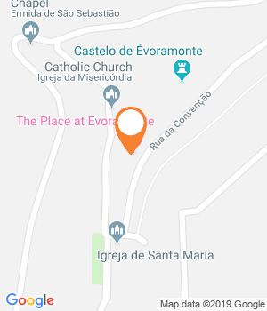
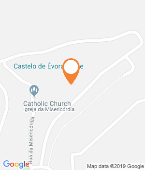
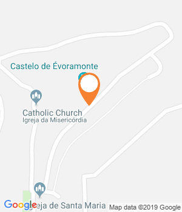
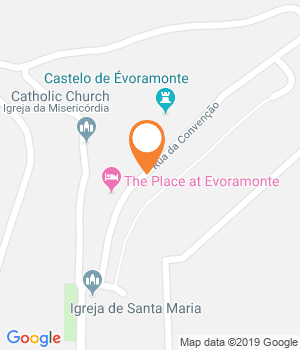

Um alojamento local, com vista para a planície, uma loja de produtos regionais, e uma empresa de visitas guiadas estão entre as novidades desta vila alentejana.

Não é um castelo dito tradicional aquele que se encontra em Évoramonte. É, aliás, o seu aspeto particular e misterioso que leva muitos a interromper o trajeto até Estremoz e a sair da Nacional 18. **Trata-se de uma peça única de arquitetura militar, atribuída aos irmãos Arruda (responsáveis por intervenções na Torre de Belém, aqueduto de Évora e Convento de Cristo) e comparada por muitos ao Fort de Salses**, em França. «Na verdade, não há motivos para acreditar que tenha sido usada com fins militares.

Acredita-se que foi mais uma espécie de demonstração de poder da Casa de Bragança», conta a guia Matilde Ruas, natural da terra. Juntamente com a mãe, criou recentemente a **Andar a Monte**, uma empresa de passeios turísticos dentro e fora das muralhas de Évoramonte. Conduz os visitantes até ao topo da fortaleza, que proporciona vistas desafogadas para a planície alentejana, e aproveita para apontar algumas das muitas lendas sobre a vila. Como a do túnel secreto que ligava o castelo à ermida de São Sebastião; ou o pêgo do Sino, ali perto, que seria um portal para outro mundo; ou ainda a pedra dos Mouros, que assinala uma trágica história de amor.

É de muitas lendas que se faz o imaginário de Évoramonte, até porque os factos escasseiam. «Sabe-se, por exemplo, que as cinco portas de entrada na vila foram mandadas construir por D. Dinis e que no século XVIII há um terramoto que destrói quase tudo», revela ainda durante o passeio que dura cerca de uma hora e que termina no escritório da Andar a Monte, mesmo no centro da vila. **Em frente está The Place, o novo alojamento local que veio dar um novo fôlego a Évoramonte.**

Mitch Webber e a mulher, Vicky, foram dois dos curiosos visitantes que se renderam à misteriosa fortaleza, há três anos. A calma alentejana convenceu-os a deixar Londres e a procurar um terreno para um futuro bed & breakfast. «Quando entrámos aqui e vimos esta paisagem soubemos que era o sítio certo», conta Mitch, no terraço, que tem vista para os montes verdes e para a fortaleza, que quase parece um prolongamento do terreno.

Sossego é prometido, até porque o **The Place** tem apenas três quartos e uma suite (com kitchenette). **Os hóspedes podem participar em sessões de observação de aves, desde o terraço, mas também petiscar por ali, já que o alojamento funciona também como cafetaria.** Saem tábuas de queijo, pizas de massa caseira, hambúrgueres feitos por Mitch e ainda pato com abóbora.

O alojamento fica a uma curta distância de carro de vários pontos de interesse, como o mercado de Estremoz ou o Cromeleque dos Almendres, mas facilmente se passa um dia no topo desta pequena vila. Além dos passeios da Andar a Monte e do **The Place** existe ainda a **loja gourmet Silveirinha**, onde também se fazem provas de vinhos, e o **Celeiro Comum de Inocência Lopes**, loja com artesanato local. Inocência replica casas alentejanas em pedras da calçada – uma lembrança que não deixa esquecer este Alentejo.

Morada

Rua de Santa Maria, 26, Évoramonte

Telefone

927603884

Custo

(€) Quarto duplo a partir de 80 euros (pequeno-almoço incluído)

* * *

* * *

GPS

Latitude : 38.7711756  
Longitude : -7.716433700000039

Comentários

Partilhar

Morada

Rua da Convenção, 29, Évoramonte

Telefone

967916857

* * *

Facebook

* * *

GPS

Latitude : 38.7718392  
Longitude : -7.715850499999988

Comentários

Partilhar

Morada

Rua de Santa Maria, 11, Évoramonte

Telefone

966759534

* * *

Facebook

* * *

GPS

Latitude : 38.7711756  
Longitude : -7.716433700000039

Comentários

Partilhar

Morada

Rua da Convenção, 31, Évoramonte

Horário

Das 10h00 às 17h00. Encerra segunda e terça.

* * *

Facebook

* * *

GPS

Latitude : 38.7716169  
Longitude : -7.715730600000029

Comentários

Partilhar

Morada

38.771842, -7.715884

Horário

Das 10h00 às 13h00 e das 14h00 às 17h00. Encerra

* * *

* * *

GPS

Latitude : 38.7713583  
Longitude : -7.716021700000056

Comentários

Partilhar

#### Leia também:

[Estremoz: Um refúgio onde até se pode dormir ao relento  
](https://www.evasoes.pt/ar-livre/estremoz-um-refugio-onde-ate-se-pode-dormir-ao-relento/)[Évoramonte: A vila alentejana com um misterioso castelo  
](https://www.evasoes.pt/fim-de-semana/evoramonte-a-vila-alentejana-com-um-misterioso-castelo/)[Marvão: uma viagem a um Alentejo diferente](https://www.evasoes.pt/evasoes-360/marvao-uma-viagem-a-um-alentejo-diferente/)
