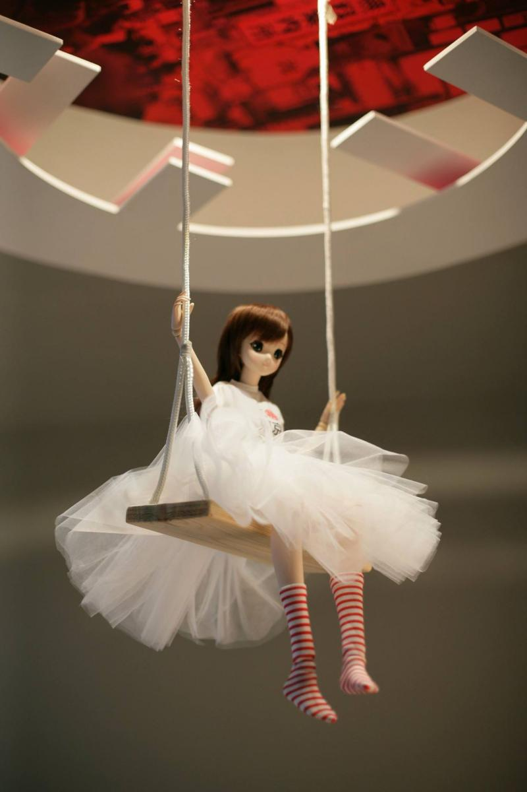

Já passaram três anos desde que a enigmática boneca japonesa do Miss Jappa, pendurada do teto num baloiço com um tule branco, começou a ser fotografada pelos clientes do restaurante. A figura, que incorpora esta personagem criativa e misteriosa Miss Jappa, tornou-se não só um símbolo do projeto de Joana e Diogo Martorell (os irmãos que detêm também o Go Natural), mas um dos cantinhos mais “instagramáveis”do restaurante , a par do néon vermelho à entrada.

A decoração pode ser um dos fatores que leva alguns clientes a entrarem no número 5 do Príncipe Real, no entanto tem sido a carta assinada pela **chef Anna Lins (uma das poucas mulheres à frente de um restaurante de sushi em Portugal)** o motivo de sucesso.

Alguns dos seus pratos de *street-food* japonesa mantêm-se desde a abertura, como **a divertida roleta russa com 6 gunkans** (rolinho de sushi invertido), um dos quais tem uma malagueta escondida que obriga o “premiado” a beber um shot de sakê; mas também o ramen de cachaço de porco e os cones de tempura, que mostram a variedade da comida deste país oriental.

**Para comemorar este terceiro aniversário há, no entanto, novos pratos a chegarem ao menu** – e algumas novidades no restaurante. A começar pela ascensão de Rui Santos, até agora subchef de Anna Lins, a chef principal. Enquanto que Anna Lins estará, cada vez mais ligada ao Go Natural, sem deixar de acompanhar o Miss Jappa, o chef Rui Santos ficará responsável por esta cozinha japonesa.

Entre as novas criações de ambos estão a fresca **salada de kinuta,** com três peixes e molho de sésamo, perfeita para o verão, mas também um **espadarte com salada de batata e uma maionese de wasabi**, além de um clássico da comida japonesa: o yosenabe, um prato de conforto em que peixe, marisco e legumes são cozinhados numa panela quente.

Não sendo este um restaurante exclusivo de sushi, a garantia de bom peixe aqui faz com que valha muito a pena provar o **novo combinado especial do chef,** que traz combinações menos óbvias.

Num restaurante dedicado à comida de rua japonesa, não falta, claro, a bebida de eleição deste povo, o sakê, no entanto há também vinho nacional e ainda uma carta de cocktails. Esta última foi desenvolvida pelo conhecido mixologista e dono do bar Cinco Lounge, David Palethorpe, e tem sofrido poucas alterações ao longo dos últimos três anos. Foram elas os **mocktails,** bebidas sem álcool (que, segundo Diogo Martorell, são cada vez mais procuradas), mas também uma nova bebida criada por Anna Lins: o Martini Rosato, com laranja e água tónica.

A última novidade no restaurante é o alargamento do horário ao fim de semana. Se aos sábados e domingos, só encontrava o espaço aberto para almoços, agora o restaurante abre de terça a sexta às 18h30, mas funciona ao almoço e jantar ao fim de semana.

> [7 restaurantes de sushi para levar as amigas que dizem não gostar](https://www.delas.pt/7-restaurantes-de-sushi-para-levar-as-amigas-que-dizem-nao-gostar/)
