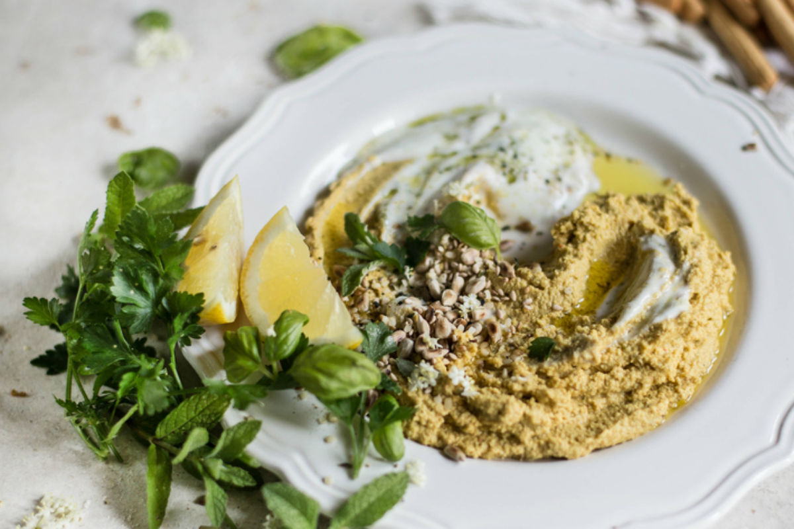

Uma entrada típica do Médio Oriente, o húmus de grão-de-bico internacionalizou-se nos últimos anos e tornou-se uma das **receitas preferidas das novas gerações**, um pouco por todo o mundo. Surgiram novas versões, como a cor-de-rosa, conseguida através do uso da beterraba, mas talvez nenhuma seja tão portuguesa como a de tremoço, criada pelo chef Luís Mourão do Epic Sana Algarve.

Foi durante a [primeira edição do Healthy Day](https://www.delas.pt/este-hotel-junto-a-praia-da-falesia-ganhou-uma-nova-alquimia/lifestyle/685137/), um evento com aulas, palestras e workshops de comida saudável que decorreu no penúltimo fim de semana de setembro, que o chef do restaurante Al Quimia se juntou à apresentadora Isabel Silva para apresentar esta proposta de húmus feita com o ingrediente que faz parte de quase todas as esplanadas portuguesas: **o tremoço**. Veja a receita.

**Ingredientes:**  
2 pimentos amarelos  
300 gramas de tremoço cozido  
2 colheres de sopa (30 ml) de sumo de limão  
2 colheres de sopa (30 ml) de azeite + 1 colher de sopa para guarnecer  
2 colheres de sopa de água  
1/2 colher de chá de cominhos moídos  
1 dente de alho descascado e picado  
4 colheres de sopa de salsa picada + 1 colher de sopa para guarnecer  
Pimenta preta a gosto

**Preparação:  
**– Asse o pimento amarelo a 180.ºC durante 20 minutos ou até perder a sua forma. Deixe arrefecer e retire a pele queimada.  
– Retire a pele ao tremoço cozido  
– Triture o tremoço no processador de alimentos e junte um pimento e meio assado, o sumo de limão, as 2 colheres de sopa de azeite, o alho picado e os cominhos. Adicione conforme necessário as 2 colheres de sopa de água, até atingir a consistência pretendida. Junte por fim a salsa picada. Retifique os temperos e reserve.  
– Pique o restante meio pimento e envolva-o com uma colher de sopa de azeite e uma colher de sopa de salsa picada. Retifique os temperos.  
– Sirva o húmus numa taça com um pouco de sal, azeite e limão, acompanhado com pão.

> [Receita. Estes queques de pequeno-almoço só têm 66 calorias](https://www.delas.pt/receita-estes-queques-de-pequeno-almoco-so-tem-66-calorias/nutricao/686599/)
