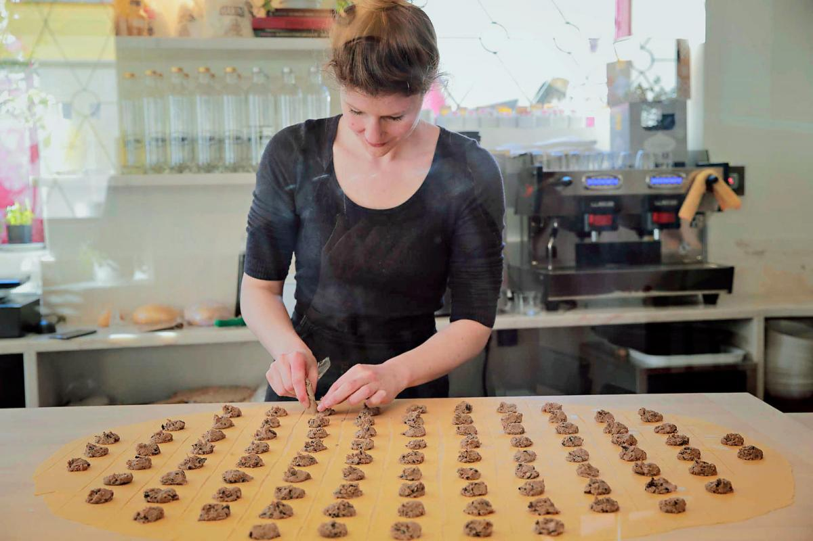
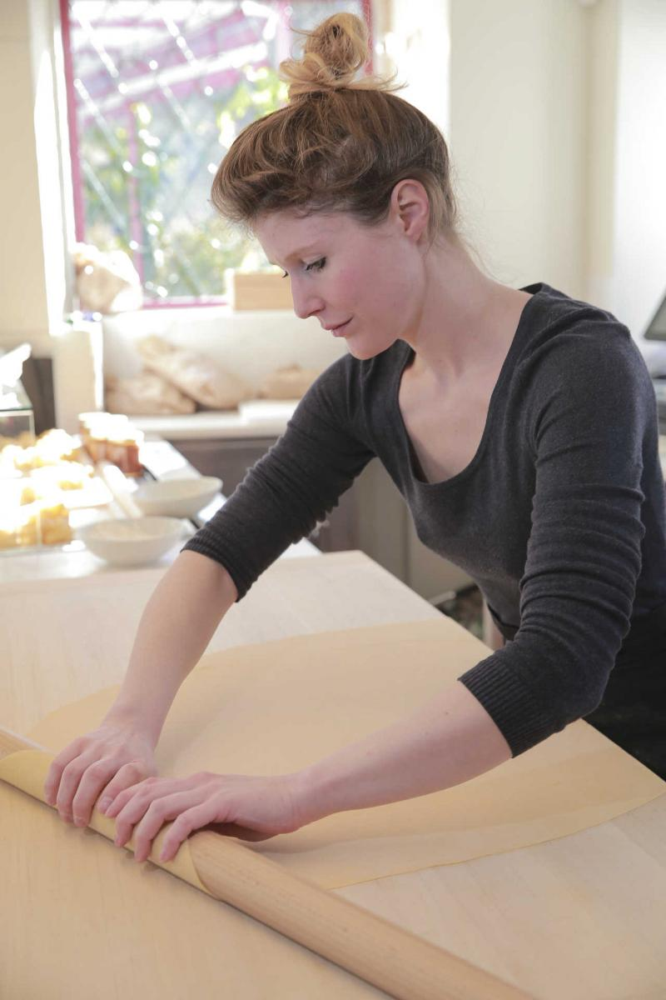
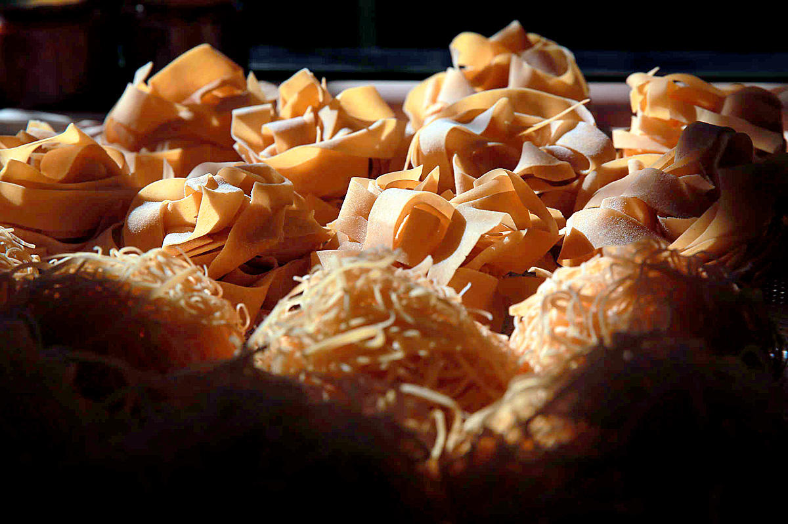

É fácil ficar hipnotizado com os movimentos de Valentina Franchi por detrás do balcão do Ruvida, o novo restaurante italiano que abriu recentemente portas na Praça da Armada, em Alcântara. Estica a massa, levanta-a como se tratasse de um fino lençol só para conferir que está homogénea, e volta a esticá-la mais um pouco com **o *mattarello*, o rolo de madeira de 1,20 metros que a acompanha.**

A bancada, também de madeira, tem mais 20 centímetros, mas por vezes não chega para as “folhas” de massa que Valentina faz todos os dias, de quarta a domingo. O processo seguinte é cortá-las, no caso dos *tagliatelle*, um a um, ou então moldá-las, como acontece com os *ravioli* em forma de barco, recheados com javali, uma carne muito usada na Toscana, como explica mais tarde o chef. **Cada massa é feita à mão, um exigente trabalho que confere a cada peça “uma textura diferente” das massas frescas feitas em máquina**, garante a especialista.

Não é preciso muito tempo para perceber que o Ruvida é um restaurante diferente ao que estamos habituados. «Costumo dizer que é comida italiana típica, atípica de encontrar em Portugal», comenta Valentina num português perfeito, apenas com um sotaque a denunciar a sua nacionalidade.

Valentina tem 33 anos e é bióloga de formação, mas o seu destino acabou por entrelaçar-se com o das massas e do companheiro e chef italiano, Michel. **A italiana chegou a Lisboa em 2014, para fazer um estágio de biologia e** apaixonou-se tanto pela cidade que quis ficar, embora não encontrasse trabalho na sua área de formação. Foi aí que se questionou sobre o que poderia trazer de diferente à cidade e, rapidamente, percebeu que a resposta estava na terra natal. “Pelo que sei, não havia ninguém a fazer massa cá com rolo de madeira, é tudo com máquinas. Mesmo hoje, penso ser a única”, descreve.

*Valentina Franchi no Ruvida, novo restaurante especializado em massas artesanais. (PAULO SPRANGER/Global Imagens)*

**Voou para Itália para tirar um curso de três meses na única escola certificada de Bolonha, a Vecchia Scuola Bolognese**, mas resolveu ficar mais tempo para testar os conhecimentos recém-adquiridos. Conseguiu um trabalho na secção de pasta do Pappagallo, o restaurante de Michel Fant e acabaram por se apaixonar.

“A Valentina estava sempre a falar de Lisboa e ao fim de algum tempo resolvemos mudar-nos”, conta o chef italiano, responsável pela outra parte da carta no Ruvida. “Fazemos todos os molhos, todos os recheios dos pratos, é mesmo tudo autêntico. De Itália vêm alguns queijos como o parmesão de 36 meses, e recorro aos mercados de Lisboa para comprar os frescos, os legumes, o marisco”, conta.

O menu divide-se em *antipasti* (as entradas), onde estão petiscos como sardinha frita com cebola agridoce, pinhões e passas, semelhante ao “escabeche” português. Michel diz que é uma entrada que, habitualmente se come em casa ou nos *bacari*, os bares de bairro, e Valentina completa-o, explicando que a sardinha reflete a grande ligação de Veneza com o mar, outrora uma grande potência marítima.

Depois das entradas, o menu segue pela secção da *pasta* e termina nos *secondi piati,* onde não se vão encontrar os típicos pratos italianos exportados pelo mundo, como a carbonara, bolonhesa ou lasanha, muito menos piza. Quando no Ruvida se faz lasanha, esporadicamente, ao domingo, é “completamente diferente”. “Muito crocante e sem aqueles queijos em cima”, diz Valentina.

Todõs os meses o menu muda, o que significa que Valentina está sempre a testar novas massas frescas, ora de beterraba e espinafres, ora formatos diferentes. A *orechiette* é um dos mais simples do menu, diz, mas cada massa é feita individualmente e desenhada com a faca e o polegar da italiana, tornando-se uma espécie de “orelha pequena”.

“Existem mais de mil massas, certamente. De 50 em 50 quilómetros, em Itália, podemos encontrar uma aldeia com um formato semelhante, mas já com um nome completamente diferente”, diz Valentina. As grandes diferenças resumem-se ao ovo: as regiões mais a norte usam, as do sul optam por sêmola de trigo e água, apenas. “As cidades mais ricas ficavam a norte, por isso podiam dar-se ao luxo para usar o ovo, mas o engraçado é que até hoje se mantém assim”, conclui.

Por fim, o que significa *Ruvida*? Diz o casal que a tradução da palavra italiana é algo como “uma superfície rugosa ou áspera”. O mesmo que as massas autênticas que trouxeram para a capital e que podem também ser compradas secas, para cozinhar em casa.

**Ruvida  
**Praça da Armada 17, Alcântara, Lisboa  
Facebook: [Ruvida](https://www.facebook.com/pages/category/Italian-Restaurant/Ruvida-1010845885783586/)  
Quinta a domingo, das 12h00 às 13h30 e das 18h30 às 23h00. Encerra segunda e terça. Preço médio: 40 euros. Menu de almoço durante a semana, 16 euros

> [Há yoga, brunch e terapias na nova boutique holística de Lisboa](https://www.delas.pt/siendo-ha-yoga-brunch-e-terapias-na-nova-boutique-holistica-de-lisboa/)

> [Lisboa: 5 parques e jardins para fazer piqueniques](https://www.delas.pt/lisboa-5-parques-e-jardins-para-fazer-piqueniques/)
